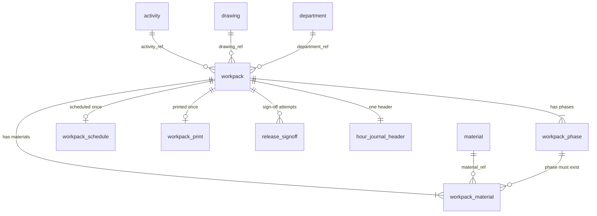
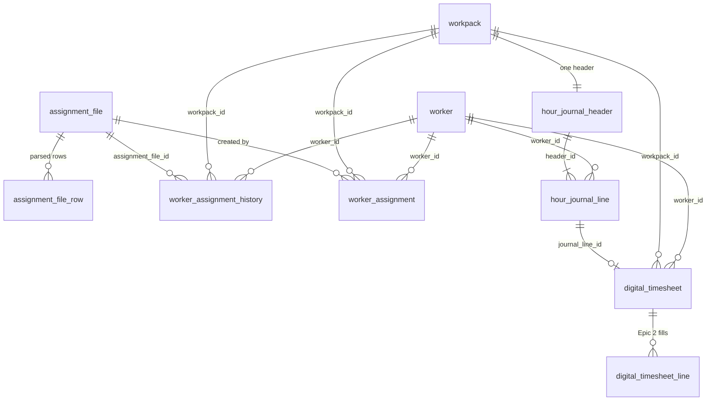
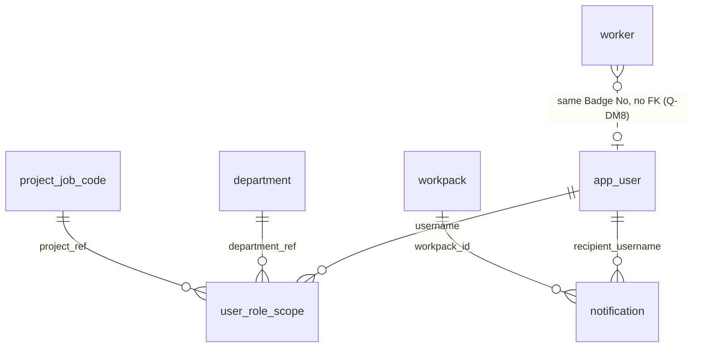

# Data model: STAR BPA POC

Status: **v0.4, 28 Oct 2026 — every open item decided** on the PO call of 28 Oct (Faraz with Khitaba and Ahsan/Usama). Prepared by Claude (BA/solution designer). Formal approval for V1 generation: see §9.
Repo path when committed: `docs/data-model.md`. Schema: `bpa` (04-conventions).
Approval chain (09 §4 item 3): Claude drafts → **Khitaba checks SORs** → **Faraz and Ahsan/Usama approve** → **Usama generates `V1__baseline_schema.sql` and `R__seed_reference_data.sql`** (09 S17).

This is the **single** domain data model for the POC (09 S16). It is not per epic and not per story. Stories' SOR Notes reference it; Flyway only delivers it. An enterprise canonical model was considered and set aside by the PO on 28 Oct 2026; this model stays scoped to the POC (S16).

Sources, in the authority order set by D57:
1. Jira stories BPA-6 to BPA-16, BPA-22, BPA-23, BPA-26 — SOR Notes and acceptance criteria (re-read 28 Oct 2026 after the 07:34–07:37 UTC updates).
2. Knowledge files `03-sor-matrix.md`, `04-conventions.md`, `00-context.md`.
3. `claude/06-epic1-decisions-draft.md` (C, D1–D65), `claude/09-architecture-decisions-2026-10-27.md` (S/G/L), and the PO decisions P1–P4 of 28 Oct recorded in §0.

**Nothing here is a new business rule.** Every column, type and constraint is traced to a story or a numbered decision. Where a story left something unstated it is marked **(A)** for ASSUMPTION, or raised in §9.

---

## 0. Change log

### v0.4 (28 Oct 2026, PO call)

Decided by Faraz with Khitaba and Ahsan/Usama on the call; recorded in 06 as D70–D72.

| Item | Decision |
| --- | --- |
| Q-DM1, Q-DM6, Q-DM9 | Accepted as proposed (Ahsan/Usama): `text` + `CHECK`; deferred composite FK; audit-column types with `'seed'` / `'system'`. |
| Q-DM2 | Accepted as drafted (Khitaba): `department.name`, `material.description`, `drawing.title` NOT NULL; `department_ref` seeded with the readable value used in stories. |
| Q-DM5, Q-DM8, Q-DM11 | Accepted as proposed. |
| Q-DM13 (D71) | `Replacement not applied: file has rejected rows` is judged **per Work Pack**: a row outcome on that Work Pack's rows; other Work Packs in the file are unaffected. |
| Q-DM14 (D70, amends G10) | No unique constraint on `assignment_file.sha256` (indexed only). An upload is a duplicate — `File already processed` — only when an earlier upload with the same `sha256` published at least one message. Every upload gets its own `assignment_file` row. A file whose rows were routed has `outcome` NULL; its rows carry the outcomes. G10's message ID still prevents a double publish. |
| Q-DM15 (D72) | A Worker removed by one replacement and re-added by a later one: the existing journal line is reopened (`Open`, new hours) and the time sheet reset to `Draft`, instead of inserting new rows. |

### v0.3 (28 Oct 2026)

**PO decisions taken by Faraz, 28 Oct 2026** (to be copied into 06 as D66–D69):

| # | Decision | Effect here |
| --- | --- | --- |
| **P1** | WBS: D365 F&O is the target-state holder of the WBS. It is designed to source WBS data from FMS, and an integration from D365 F&O back to FMS carries any updates. | `wbs_ref` keeps the label **D365 F&O Project Management** (C8c unchanged). The FMS → D365 feed and the D365 → FMS update flow are recorded as integration notes (§3.2). Shape unchanged. *Reading confirmed by the PO, 28 Oct.* |
| **P2** | Upload while `assignment_state = Replacing` → **"Replacement already in progress"** (BPA-13 wording). Upload while `Assigning` → "Assignment still in progress; try again later" (unchanged). | Closes Q-DM12. Both strings are **row** outcomes (§7.3). BPA-12 outline row and the D61 text in 06 to be corrected (§10.2). |
| **P3** | The superseded revision shown in the BPA-16 email travels as the process variable `supersededRevision` from the `DrawingRevised` message to `SendTask_NotifyRecipients`. **Not stored.** | Closes Q-DM7. No column added to `drawing_revision`. |
| **P4** | Drop `workpack.created_by`; the audit column `created_by` holds the same Camunda username. | Closes Q-DM3. BPA-6 SOR Notes to be amended (§10.2). |

**Defects fixed (no rule change):**

| # | Defect in v0.2 | Fix |
| --- | --- | --- |
| F1 | `assignment_file_row.row_number` NOT NULL made BPA-13 scenario 2 untestable: the result must show E1099 "Hours loaded; not removed", but E1099 is **not a row in the file**, and the result is rebuilt only from `assignment_file_row` (D49). | `row_number` nullable; `replace-worker-assignment` writes one **synthetic row** (row_number NULL) per removed Worker kept because hours are loaded. §5.2. **(A)** |
| ~~F2~~ | *Withdrawn after QA.* The draft "fixed" §3.8's rule "latest revision not Superseded" as unsourced. It is sourced: BPA-8 SOR Notes define `drawingApproved` on "the latest revision (by registered_at) that is not Superseded". | v0.2 text restored; both definitions now cited separately (§3.8). |
| F3 | `worker_assignment_history.worker_assignment_id` FK with `ON DELETE SET NULL` (Q-DM10) — loses the identifier the history exists to keep. | Plain `uuid NOT NULL`, **no FK**: a historical identifier, the same pattern as `audit_log.record_id`. Closes Q-DM10. Deleting a removed Worker's `worker_assignment` row is itself **(A)** — BPA-13 says only "no longer assigned" — and re-adding that Worker later is Q-DM15. |
| F4 | Q-DM2 called `department`, `material`, `drawing` "required by stories but defined by none". | They are also required by **locked decision S20** (reference lists `GET departments`, `drawings`, `materials`) and named in BPA-6 / BPA-16 backgrounds. Tables are now sourced; only their non-key columns stay **(A)**. |
| F5 | `cbs_activity` grain unstated (Q-DM4). | BPA-15 derives **one** `cbs_code_ref` per time sheet from the activity, which only works if an activity has at most one CBS code. `UNIQUE(activity_ref)` added, marked derived **(A)**. |
| F6 | `remarks varchar(250)` vs BPA-22 "`remarks text` max 250". | `text` + `CHECK (char_length(remarks) <= 250)`, consistent with Q-DM1. |
| F7 | §1.3 did not say what SOR a `uuid` foreign key carries; v0.2 labelled `worker_id` myPeople but `workpack_id` POC database without a rule. | Rule made explicit (§1.3): a uuid FK carries the SOR of the entity it identifies — as BPA-14, BPA-15 and BPA-22 state for `worker_id`. No label changed. |
| F8 | Wrong cross-references: §1.2 pointed to `audit_log` at §6.3 (it is §6.1); §1.4 put open questions in §8 (they are §9); §8 pointed to "§9" for the BPA-15 issue (it is §10.2); §10.3 said "(A)" columns are collected in §11 (§11 is seed sizing). | Corrected. |
| F9 | `assignment_file` SOR reason cited "D33 rule 12", which 06 retires (D58 keep-list and the 06 "Superseded" paragraph) while BPA-12 still cites it. | Reason now cites D49, D58 and BPA-12. Contradiction logged in §10.1. |
| F10 | §4.4 put the lead-time rule on `planned_start_date` only. BPA-11's outline rejects **planned end** 27 Oct with "Date cannot be earlier than 28 Oct 2026". | Both planned dates worker-checked against today + lead time (§4.4). |
| F11 | `audit_log` old/new value format unstated; a plain cast of `numeric(7,2)` gives `250.00`, BPA-23 asserts `250`. | Canonical text format defined (§6.1). |
| F12 | History idempotency key used `source_file` (a file name, not unique), so a second replacement under the same name would lose rows. | `assignment_file_id` added to `worker_assignment_history`; key uses it (§5.4). |
| F13 | Composite FK (Q-DM6) would break BPA-23 corrections done by delete-and-insert, and delete-and-insert would also break the BPA-23 audit row. | Phases and materials updated in place; FK `DEFERRABLE INITIALLY DEFERRED` (§4.2, §4.3). |
| F14 | `lookahead_item` had no key though BPA-11 reads "the Look-Ahead row" for a drawing. | `UNIQUE(design_dwg_ref)` **(A)** (§3.11). |
| F15 | `text` `_ref` FKs labelled inconsistently (`lookahead_item.design_dwg_ref` PCON vs `cutting_sheet.drawing_ref` Document Control); §7.2 omitted `app_user`. | §1.3 rule extended to `_ref` FKs; relabelled; §7.2 corrected. |
| F16 | `decline_reason` CHECK accepted an empty or blank string. | `btrim(decline_reason) <> ''` (§4.6). |
| F17 | ERD cardinalities inconsistent (header `o|` vs `||`; file → rows `|{` though a file may have no rows). | Aligned. |

**Found by the v0.3 QA pass, raised rather than fixed** (they need a rule): Q-DM14 (duplicate-file rule vs "resend the file"), Q-DM15 (re-adding a removed Worker), and the file success outcome (in Q-DM14).

**Recommendations applied as PROPOSED** (the approver named in §9 confirms in the approval chain; nothing below is a business rule): Q-DM1 `text` + `CHECK`; Q-DM5 inactive worker is a no-op; Q-DM6 composite FK; Q-DM8 no FK; Q-DM9 audit types and `'seed'`; Q-DM11 `app_user` outside `audit_log`.

### v0.2 (28 Oct 2026)
Sceptical QA pass against the Jira stories and the decision logs; 17 defects in v0.1 fixed or raised.

---

## 1. How to read this document

### 1.1 Conventions applied (04-conventions)

| Rule | Applied as |
| --- | --- |
| Schema | `bpa` |
| Table names | snake_case, singular |
| Primary key | `id uuid` — **one exception**, `app_user`, keyed by `username` (D63) |
| Columns holding another system's identifier | end in `_ref`, hold that system's ID as text |
| Audit columns on every table | `created_at`, `created_by`, `updated_at`, `updated_by` |
| Timestamps | `timestamptz`, stored UTC (09 S9) |
| Business dates | `date`, evaluated in **Asia/Riyadh** by the application clock, never by the database (09 S9, D28) |
| Enumerations | `text` + `CHECK (col IN (…))` (Q-DM1, decided 28 Oct) |

### 1.2 Audit columns (Q-DM9, decided 28 Oct)

Every table in §3–§6 carries these four; they are **not repeated** in the column tables.

| Column | Type | Null | Note |
| --- | --- | --- | --- |
| `created_at` | `timestamptz` | NOT NULL | UTC |
| `created_by` | `text` | NOT NULL | Camunda username (D63); literal `'seed'` for rows written by `R__seed_reference_data.sql`; `'system'` for the S22 start-up job |
| `updated_at` | `timestamptz` | NOT NULL | UTC; equals `created_at` on insert |
| `updated_by` | `text` | NOT NULL | as `created_by` |

`04-conventions.md` names the four columns only; types, nullability and the seed value are decided here (Q-DM9) and go into 04 with the L16 update (Ahsan).

`audit_log` (§6.1) is the only table **without** these four, because it is itself the audit record (D64).

### 1.3 The SOR column

Every field has exactly one SOR. The SOR column names:
- **POC database** — the POC owns the value. A reason is given on every such table, as the project rules require.
- **A real system** (D365 F&O, FMS, myPeople, P6, Camunda) — the value is a **seeded copy**, labelled with the system that owns it after go-live. Each such table carries `COMMENT ON TABLE` naming the SOR (09 S17).

**Surrogate keys.** `id uuid` primary keys have no SOR: POC-internal row identifiers that exist only because 04-conventions requires them and are never exchanged with another system. Shown as `—`.

**Foreign keys** (F7, F15). A column pointing at another table — a `uuid` to its `id` or a `text` `_ref` to its business key — carries the SOR of **the entity it identifies**, as the stories state it: `worker_id` → myPeople (BPA-14, BPA-15, BPA-22); `workpack_id`, `header_id`, `journal_line_id` → POC database; any `drawing_ref` → D365 F&O Document Control.

### 1.4 Markers used in the column tables

| Marker | Meaning |
| --- | --- |
| **(A)** | ASSUMPTION — no story or decision states this; I inferred it |
| **worker-checked** | enforced by a job worker, not by the database (see §1.5) |
| **Q-DM*n*** | an item in §9 |
| **P*n*** | a PO decision of 28 Oct (§0) |

### 1.5 Rules the database cannot hold

Three categories of rule in the stories are **not** expressible as PostgreSQL constraints, and are listed as worker-checked rather than in the Constraint column:

1. **Rules referencing "today"** — `completion_date` not in the past (D20); `planned_start_date` and `planned_end_date` `>= today + lead_time_days` (D9, BPA-11). `CHECK` cannot call a non-`IMMUTABLE` function, and the clock is injected (09 S9).
2. **Rules referencing application config** — anything using `lead_time_days`, which is config, not data (§6.2).
3. **Cross-row and cross-table rules** — "every `workpack_material` has a reservation" (BPA-8).

All of these throw `WORKPACK_INVALID` or `SCHEDULE_INVALID` from the save worker, returning `validationMessages` (D56, 09 S14).

### 1.6 Group names

The seven Camunda groups (09 S6, BPA-25): `time-method-analyst`, `project-engineer`, `production-planner`, `workpack-owner`, `ppc-team`, `supervisor`, `production-team`.

---

## 2. Domain map

Six domains (09 S16), plus one cross-cutting audit table. **30 tables.**

| # | Domain | Tables | Count | SOR |
| --- | --- | --- | --- | --- |
| A | Reference data copies | `project_job_code`, `wbs`, `activity`, `cbs_activity`, `department`, `material`, `drawing`, `drawing_revision`, `material_reservation`, `cutting_sheet`, `lookahead_item`, `worker` | 12 | Real systems (copies) |
| B | Work Pack | `workpack`, `workpack_phase`, `workpack_material`, `workpack_schedule`, `workpack_print`, `release_signoff` | 6 | POC database |
| C | Assignment | `assignment_file`, `assignment_file_row`, `worker_assignment`, `worker_assignment_history` | 4 | POC database |
| D | Hours | `hour_journal_header`, `hour_journal_line`, `digital_timesheet`, `digital_timesheet_line` | 4 | POC database |
| E | Notification | `notification` | 1 | POC database |
| F | Access scope | `app_user`, `user_role_scope` | 2 | Camunda identity (`app_user.username`, `group_id`); POC database (the scope rows) |
| G | Audit | `audit_log` | 1 | POC database |

### 2.1 ERD — the Work Pack spine

### 2.2 ERD — reference data copies (domain A)

### 2.3 ERD — assignment and hours (domains C, D)

`worker_assignment_history.worker_assignment_id` is deliberately **not** drawn: it has no FK (F3).

### 2.4 ERD — access scope and notification (domains E, F)

---

## 3. Domain A — reference data copies

All seeded by `R__seed_reference_data.sql` (09 S17, L2). None is written at runtime, with one exception: `drawing_revision` is seeded and then also written by the drawing-revisions endpoint from D365 events (D45, D53, G6).

### 3.1 `project_job_code`

| Column | Type | Null | Constraint | SOR | Source |
| --- | --- | --- | --- | --- | --- |
| `id` | `uuid` | NOT NULL | PK | — (§1.3) | 04-conventions |
| `project_ref` | `text` | NOT NULL | **UNIQUE** | D365 F&O Project Management | BPA-6; C8a |
| `job_code_ref` | `text` | NOT NULL **(A)** | | FMS (created by PCON Planner) | BPA-6; C8b |

`UNIQUE(project_ref)` enforces "one Job Code per project" — **ASSUMPTION** (D13). Two SORs in one table is deliberate; each *column* still has exactly one. Needs a column comment (§7.2).

### 3.2 `wbs`

| Column | Type | Null | Constraint | SOR | Source |
| --- | --- | --- | --- | --- | --- |
| `id` | `uuid` | NOT NULL | PK | — | |
| `wbs_ref` | `text` | NOT NULL | UNIQUE | D365 F&O Project Management | BPA-6; C8c; **P1** |
| `project_ref` | `text` | NOT NULL **(A)** | FK → `project_job_code(project_ref)` | D365 F&O Project Management | BPA-6; C8a |

**Integration note (P1, PO 28 Oct).** In the target landscape D365 F&O sources WBS data from FMS, and a D365 F&O → FMS integration carries updates. The POC holds a seeded copy and implements neither flow; if made live, the FMS side is batch/file (project rule for partner-side integrations). The FRD conflict behind C8c (FRD-7 §7.4, §7.6 s1 name FMS) stays recorded; STAR question 2 stays open.

### 3.3 `activity`

| Column | Type | Null | Constraint | SOR | Source |
| --- | --- | --- | --- | --- | --- |
| `id` | `uuid` | NOT NULL | PK | — | |
| `activity_ref` | `text` | NOT NULL | UNIQUE | P6, read through the D365 PMS database | BPA-6; C13 |
| `activity_name` | `text` | NOT NULL **(A)** | | P6 | BPA-6; C13 |
| `wbs_ref` | `text` | NOT NULL **(A)** | FK → `wbs(wbs_ref)` | D365 F&O Project Management | BPA-6; C8c |
| `fac_crpo` | `text` | NULL | | P6 — **contradicted**: FRD-10 §10.8.1 calls it a D365-only field (C13) | BPA-6 |
| `fac_type` | `text` | NULL | | P6 | BPA-6 |
| `fac_name` | `text` | NULL | | P6 | BPA-6 |
| `discipline` | `text` | NULL | | P6 | BPA-6 |
| `baseline_start` | `date` | NULL | | P6 | BPA-6 |
| `baseline_end` | `date` | NULL | | P6 | BPA-6 |
| `budgeted_units` | `numeric(9,2)` | NULL | | P6 | BPA-6 |

The last seven are nullable on evidence: BPA-6 has an activity with no plan data (A-2299) and the Work Pack is still created. Nothing is validated against them (D17). Needs a column comment — `wbs_ref` has a different SOR from the table.

### 3.4 `cbs_activity`

| Column | Type | Null | Constraint | SOR | Source |
| --- | --- | --- | --- | --- | --- |
| `id` | `uuid` | NOT NULL | PK | — | |
| `activity_ref` | `text` | NOT NULL **(A)** | FK → `activity(activity_ref)`; **UNIQUE** (derived **(A)**, F5) | P6 | BPA-15 |
| `cbs_code_ref` | `text` | NOT NULL **(A)** | | D365 F&O Cost Control Report | BPA-15; D40 |

`UNIQUE(activity_ref)`: BPA-15 derives a single `cbs_code_ref` per time sheet from the activity, so an activity has at most one CBS code. An activity with **no** row gives a blank CBS (BPA-15, A-2299).

### 3.5 `department` — sourced table, non-key columns ASSUMPTION (Q-DM2)

| Column | Type | Null | Constraint | SOR | Source |
| --- | --- | --- | --- | --- | --- |
| `id` | `uuid` | NOT NULL | PK | — | |
| `department_ref` | `text` | NOT NULL | UNIQUE | D365 F&O (organisation / financial dimension) | BPA-6; D18; 09 S20 |
| `name` | `text` | NOT NULL **(A)** | | D365 F&O | **(A)** |

Required by BPA-6 (option list; background "department Fabrication"), the `workpack.department_ref` FK, BPA-15/BPA-16 scope checks, and the locked `GET /api/v1/departments` (S20). Stories refer to departments by a readable value ("Fabrication", "Painting"); whether that value is the `department_ref` or the `name` is a seed choice — **(A)**: seed `department_ref` = the readable value, so story data works unchanged.

### 3.6 `material` — sourced table, non-key columns ASSUMPTION (Q-DM2)

| Column | Type | Null | Constraint | SOR | Source |
| --- | --- | --- | --- | --- | --- |
| `id` | `uuid` | NOT NULL | PK | — | |
| `material_ref` | `text` | NOT NULL | UNIQUE | D365 F&O Product Information Management | BPA-6; C12, D54; 09 S20 |
| `description` | `text` | NOT NULL **(A)** | | D365 F&O PIM | **(A)** |

### 3.7 `drawing` — sourced table, non-key columns ASSUMPTION (Q-DM2)

| Column | Type | Null | Constraint | SOR | Source |
| --- | --- | --- | --- | --- | --- |
| `id` | `uuid` | NOT NULL | PK | — | |
| `drawing_ref` | `text` | NOT NULL | UNIQUE | D365 F&O Document Control | BPA-6, BPA-16; C15; 09 S20 |
| `title` | `text` | NOT NULL **(A)** | | D365 F&O Document Control | **(A)** |

Required by BPA-16: `POST /api/v1/drawing-revisions` returns **404 `Drawing not found`** for an unknown drawing, which only works if drawings exist independently of their revisions (G6).

### 3.8 `drawing_revision`

| Column | Type | Null | Constraint | SOR | Source |
| --- | --- | --- | --- | --- | --- |
| `id` | `uuid` | NOT NULL | PK | — | |
| `drawing_ref` | `text` | NOT NULL | FK → `drawing(drawing_ref)`; **UNIQUE(drawing_ref, revision)** | D365 F&O Document Control | BPA-8, BPA-16; C15 |
| `revision` | `text` | NOT NULL | part of the unique key | D365 F&O Document Control | BPA-16; D42 |
| `status` | enum (§7.1) `[IFR, IFA, IFI, IFC, As-Built, Superseded]` | NOT NULL | | D365 F&O Document Control | BPA-8, BPA-16; D23, D60 |
| `registered_at` | `timestamptz` | NOT NULL | | D365 F&O Document Control | BPA-16; D42 |

- **Read-only copy.** Seeded; at runtime written only by the drawing-revisions endpoint from a `DrawingRevised` event (D41, D45, D53). G6 phrases this as the API "marking the previous revision Superseded"; per D53 it applies only what the event reports.
- `revision` is **opaque text** — the POC never parses or orders the label (D42). Two definitions are in use, both sourced:
  - **Latest revision** (BPA-16, D42): most recent `registered_at`.
  - **Approval check** (BPA-8 SOR Notes, `drawingApproved`): status of the latest revision by `registered_at` **that is not Superseded** is IFC or As-Built.
  They give the same answer whenever the newest row is not Superseded, which is every seeded and story case; they differ only if D365 ever reported the newest revision as Superseded.
- `Superseded` is applied only as the event's `supersededRevision` reports it; the POC never decides it (D45, D53). If the event names no superseded revision, or one not in the copy (BPA-16 `Z9`), nothing is marked and, for `Z9`, a warning is logged.
- Approved = `IFC` or `As-Built` (D10, unchanged by D60). A drawing with **no** revision row gives `drawingApproved = false` (BPA-8, ASSUMPTION).
- **`supersededRevision` is not stored** (P3). It travels as a process variable from the `DrawingRevised` message to `SendTask_NotifyRecipients`, which prints it as "previous revision" in the email. When absent, the email's previous-revision field is blank **(A)**.

### 3.9 `material_reservation`

| Column | Type | Null | Constraint | SOR | Source |
| --- | --- | --- | --- | --- | --- |
| `id` | `uuid` | NOT NULL | PK | — | |
| `traceability_number` | `text` | NOT NULL **(A)** | | D365 F&O (PPC) | BPA-8; C12, D54 |
| `drawing_ref` | `text` | NOT NULL **(A)** | FK → `drawing(drawing_ref)` | D365 F&O Document Control | BPA-8; C5 |
| `material_ref` | `text` | NOT NULL **(A)** | FK → `material(material_ref)` | D365 F&O PIM | BPA-8; C12 |

Reservations are keyed by **drawing + material** (C5), not by Work Pack. `materialsReserved` is true when every `workpack_material` has a reservation for `(workpack.drawing_ref, material_ref)` — worker-checked, cross-table (BPA-8). Three different D365 modules appear here; all three columns need comments.

### 3.10 `cutting_sheet`

| Column | Type | Null | Constraint | SOR | Source |
| --- | --- | --- | --- | --- | --- |
| `id` | `uuid` | NOT NULL | PK | — | |
| `cutting_sheet_ref` | `text` | NOT NULL **(A)** | | FMS nesting | BPA-10; D30 |
| `drawing_ref` | `text` | NOT NULL **(A)** | FK → `drawing(drawing_ref)` | D365 F&O Document Control | BPA-10; D30 |

Linked **by drawing**, not by Work Pack — the key and the empty case are ASSUMPTION (D30). No cutting sheet → the print shows `No cutting sheet available`.

### 3.11 `lookahead_item`

| Column | Type | Null | Constraint | SOR | Source |
| --- | --- | --- | --- | --- | --- |
| `id` | `uuid` | NOT NULL | PK | — | |
| `design_dwg_ref` | `text` | NOT NULL **(A)** | FK → `drawing(drawing_ref)`; **UNIQUE** **(A)** (F14) | D365 F&O Document Control (§1.3) | BPA-11; D48 |
| `shop_drg_mark_plan_date` | `date` | NULL | | D365 F&O PCON | BPA-11; D48 |
| `assembly_plan_date` | `date` | NULL | | D365 F&O PCON | BPA-11; D48 |
| `weld_map_plan_date` | `date` | NULL | | D365 F&O PCON | BPA-11; D48 |

Matching key: **Design Dwgs = the Work Pack's drawing** (BPA-11). One row per drawing, because BPA-11 reads "the Look-Ahead row for DWG-118". No row → `No Look-Ahead plan dates for <drawing>` and scheduling proceeds. Read-only labels: Shop Drg Mark, Assembly / Integration, Weld Map Drawing. L8's "3 weeks per project" is met by spreading the seeded plan dates over three weeks; there is no week or project column.

### 3.12 `worker`

| Column | Type | Null | Constraint | SOR | Source |
| --- | --- | --- | --- | --- | --- |
| `id` | `uuid` | NOT NULL | PK | — | |
| `employee_ref` | `text` | NOT NULL | **UNIQUE** | myPeople | BPA-22; C1, C11, C14, **C17** |
| `name` | `text` | NOT NULL **(A)** | | myPeople | BPA-22; C14 |
| `role` | `text` | NOT NULL **(A)** | | myPeople | BPA-22, BPA-14 |
| `designation` | `text` | NOT NULL **(A)** | | myPeople | BPA-22, BPA-14 |
| `agency_flag` | `boolean` | **NOT NULL** (stated) | | myPeople (agency tag) | BPA-22; C11 — **ASSUMPTION**, field name and values unconfirmed (STAR question 7) |
| `cost_centre_ref` | `text` | NULL | | myPeople — **ASSUMPTION** that myPeople carries it; the code values are D365 financial-dimension codes, which does not change the SOR | BPA-15; D40 |

- `employee_ref` **holds the Badge No** (D59). Contradiction C17 is recorded in §10.1. Stories label it "Employee ID" on screen (BPA-15); the value is the Badge No.
- Worker **active status is not checked** in the POC (BPA-22, ASSUMPTION), so no `active` column exists (Q-DM5).

---

## 4. Domain B — Work Pack

### 4.1 `workpack`

| Column | Type | Null | Constraint | SOR | Source |
| --- | --- | --- | --- | --- | --- |
| `id` | `uuid` | NOT NULL | PK | — | |
| `workpack_number` | `text` | NOT NULL | **UNIQUE**; `CHECK (workpack_number ~ '^WP-[0-9]{6}$')` | POC database (real SOR FMS, D47) | BPA-6; D15 |
| `activity_ref` | `text` | NOT NULL | FK → `activity(activity_ref)` | P6 via D365 PMS | BPA-6; C13 |
| `drawing_ref` | `text` | NOT NULL | FK → `drawing(drawing_ref)` | D365 F&O Document Control | BPA-6; C15 |
| `department_ref` | `text` | NOT NULL | FK → `department(department_ref)` | D365 F&O | BPA-6; D18 |
| `completion_date` | `date` | NOT NULL | **worker-checked**: not before today, Asia/Riyadh | POC database (C2) | BPA-6; D20, D28 |
| `status` | enum (§7.1) `[Draft, Released, In Progress, Completed]` | NOT NULL | default `Draft` **(A)** | POC database (C2) | BPA-6, BPA-9 |
| `assignment_state` | enum (§7.1) `[AwaitingFile, Assigning, Assigned, Replacing]` | **NULL** until the print is stored (stated) | | POC database | BPA-10, BPA-12, BPA-13; **D61** |
| `process_instance_key` | `bigint` | NOT NULL | **UNIQUE** | POC database — re-run key | BPA-6; D65 |

**SOR reason:** the POC plays FMS's role for Work Packs. Real SOR FMS, copied to D365 via Int-4.1 (C2, D47). Batch/file if made live.

Notes:
- `workpack_number` is generated, read-only, gaps allowed (D15, ASSUMPTION). The format `CHECK` is safe because the POC generates every value.
- **No `created_by` business column** (P4): the creator is the audit `created_by`, the Camunda username (D63).
- `process_instance_key UNIQUE` is what makes `save-workpack` idempotent on retry (D65, 09 S7).
- **No `project_ref` column.** A Work Pack's project is derived from its activity (BPA-16, C8a); storing it would create a second copy of one value.

### 4.2 `workpack_phase`

| Column | Type | Null | Constraint | SOR | Source |
| --- | --- | --- | --- | --- | --- |
| `id` | `uuid` | NOT NULL | PK | — | |
| `workpack_id` | `uuid` | NOT NULL | FK → `workpack(id)`; **UNIQUE(workpack_id, phase)** | POC database | BPA-6 |
| `phase` | enum (§7.1) `[Engineering, Cutting, Welding, Finishing]` | NOT NULL | part of the unique key | POC database | BPA-6; FRD-7 §7.4 |
| `manhours` | `numeric(7,2)` | NOT NULL | `CHECK (manhours > 0 AND manhours <= 99999.99)` | POC database | BPA-6; **D14** |

**SOR reason:** part of the Work Pack, which the POC masters (C2, D47).
**Corrections update rows in place** (F13): `save-workpack` on a BPA-23 correction updates an existing `(workpack_id, phase)` row, inserts new phases, and deletes only phases no longer selected. Delete-and-reinsert would change `id` and break the BPA-23 audit row (old value 250 → new 300 on the same record).
`UNIQUE(workpack_id, phase)` produces `Phase Cutting is listed twice`. Boundaries proven in BPA-6: 0 rejected, 0.01 accepted, 0.001 rejected (2 dp), 99999.99 accepted, 100000 rejected. The worker checks the 2-decimal rule before saving so the message is exact; `numeric(7,2)` would otherwise round silently.

### 4.3 `workpack_material`

| Column | Type | Null | Constraint | SOR | Source |
| --- | --- | --- | --- | --- | --- |
| `id` | `uuid` | NOT NULL | PK | — | |
| `workpack_id` | `uuid` | NOT NULL | FK → `workpack(id)`; part of the composite FK below | POC database | BPA-6 |
| `material_ref` | `text` | NOT NULL | FK → `material(material_ref)` | D365 F&O PIM | BPA-6; C12 |
| `phase` | enum (§7.1) | NOT NULL | composite FK `(workpack_id, phase)` → `workpack_phase(workpack_id, phase)` `DEFERRABLE INITIALLY DEFERRED` (Q-DM6, decided 28 Oct) | POC database | BPA-6; **D16** |

**SOR reason:** part of the Work Pack, which the POC masters (C2, D47).
The composite FK is defence in depth; `save-workpack` still checks D16 first so the user sees `Phase Finishing is not selected for this Work Pack` rather than a constraint violation (D56). It is **deferred to commit** (F13) so a correction that moves materials and removes a phase in one save does not depend on statement order. Material rows are also updated in place.
**No unique constraint on `(workpack_id, material_ref)`** — no story forbids the same material twice (Q-DM4, not blocking).

### 4.4 `workpack_schedule`

| Column | Type | Null | Constraint | SOR | Source |
| --- | --- | --- | --- | --- | --- |
| `id` | `uuid` | NOT NULL | PK | — | |
| `workpack_id` | `uuid` | NOT NULL | **UNIQUE**; FK → `workpack(id)` | POC database | BPA-11; D27, D65 |
| `planned_start_date` | `date` | NOT NULL | **worker-checked**: `>= today + lead_time_days`, Asia/Riyadh | POC database | BPA-11; D9, D28 |
| `planned_end_date` | `date` | NOT NULL | `CHECK (planned_end_date >= planned_start_date)`; **worker-checked**: `>= today + lead_time_days`, Asia/Riyadh (F10) | POC database | BPA-11; D9 |
| `scheduled_by` | `text` | NOT NULL | Camunda username | Camunda identity | BPA-11; D63 |

**SOR reason:** schedule of a POC-mastered Work Pack (C2).
`UNIQUE(workpack_id)` carries **D27, no rescheduling**. The lead-time rule applies to **both** dates (BPA-11 outline: planned start 27 Oct rejected, 28 Oct accepted, planned end 27 Oct rejected, each "Date cannot be earlier than 28 Oct 2026"). The worker checks lead time before end ≥ start, so a planned end of 27 Oct gets the lead-time message. Planned end after `completion_date` is **allowed** with a non-blocking notice (D26); equal dates give no notice. `scheduled_by` is kept (unlike P4) because BPA-11 asserts on it and it is not always the row's creator.

### 4.5 `workpack_print`

| Column | Type | Null | Constraint | SOR | Source |
| --- | --- | --- | --- | --- | --- |
| `id` | `uuid` | NOT NULL | PK | — | |
| `workpack_id` | `uuid` | NOT NULL | **UNIQUE**; FK → `workpack(id)` | POC database | BPA-10; D29 |
| `file` | `bytea` | NOT NULL | the PDF | POC database | BPA-10; D29 |
| `sha256` | `text` | NOT NULL | unchanged on a re-run | POC database | BPA-10; 09 S1 |
| `generated_at` | `timestamptz` | NOT NULL | | POC database | BPA-10 |

**SOR reason:** record of the print issued to the shop floor (FRD-7 §7.3.3 audit trail).
The stable `sha256` on re-run is achievable only because the PDF's creation date comes from the injected clock (09 S1).

### 4.6 `release_signoff`

| Column | Type | Null | Constraint | SOR | Source |
| --- | --- | --- | --- | --- | --- |
| `id` | `uuid` | NOT NULL | PK | — | |
| `workpack_id` | `uuid` | NOT NULL | FK → `workpack(id)` | POC database | BPA-9 |
| `task_key` | `bigint` | NOT NULL | **UNIQUE** — re-run key | POC database | BPA-9; D65, 09 S7 |
| `decision` | enum (§7.1) `[Approved, Declined]` | NOT NULL | | POC database | BPA-9 |
| `decline_reason` | `text` | NULL | `CHECK (decision <> 'Declined' OR btrim(coalesce(decline_reason, '')) <> '')` (F16) | POC database | BPA-9; D3 |
| `signed_off_by` | `text` | NOT NULL | Camunda username | Camunda identity | BPA-9; D63 |
| `signed_off_at` | `timestamptz` | NOT NULL | | POC database | BPA-9 |

**SOR reason:** approval record of the POC workflow.
Many rows per Work Pack — decline history lives here while `confirmMessage` keeps only the latest reason (D51). The backend also returns 400 `Reason is required` (09 S14).

---

## 5. Domains C, D, E, F

### 5.1 `assignment_file` (C)

| Column | Type | Null | Constraint | SOR | Source |
| --- | --- | --- | --- | --- | --- |
| `id` | `uuid` | NOT NULL | PK | — | |
| `file_name` | `text` | NOT NULL **(A)** | | POC database | BPA-12 |
| `sha256` | `text` | NOT NULL | **indexed, not unique** (D70) | POC database | BPA-12; D33 r7; D70 |
| `uploaded_by` | `text` | NOT NULL | Camunda username | Camunda identity | BPA-12; D63 |
| `received_at` | `timestamptz` | NOT NULL | | POC database | BPA-12 |
| `outcome` | `text` | NULL | file-level result line (§7.3); **NULL when the rows were routed** — the rows carry the outcomes (D70) | POC database | BPA-12; D49; D70 |

**SOR reason:** POC intake log of uploaded assignment files (FRD-7 §7.3.3 audit trail; D49, D58; BPA-12 "Upload is recorded") (F9).
**No `workpack_id`** — one file may carry rows for several Work Packs (D33 rule 3).

**Duplicate files (D70, Q-DM14).** An upload is a duplicate — file-level outcome `File already processed`, nothing published — only when an earlier `assignment_file` with the same `sha256` published at least one message (routed at least one row). A file whose rows were all "Not processed", "not ready" or rejected at routing can be resent unchanged, as D62 tells the user to. Every upload, duplicates included, gets its own row, so `GET /api/v1/assignment-files/{id}/result` always has something to show. G10's message ID (`sha256:workpackNumber`) still prevents a double publish if two identical uploads race.

### 5.2 `assignment_file_row` (C)

| Column | Type | Null | Constraint | SOR | Source |
| --- | --- | --- | --- | --- | --- |
| `id` | `uuid` | NOT NULL | PK | — | |
| `assignment_file_id` | `uuid` | NOT NULL | FK → `assignment_file(id)` | POC database | BPA-12; D49 |
| `row_number` | `integer` | **NULL** | NULL only on a synthetic row (F1) | POC database | BPA-12, BPA-13 |
| `workpack_number` | `text` | NULL | **raw** — not an FK | POC database | BPA-12 |
| `badge_no` | `text` | NULL | **raw** — not an FK | POC database | BPA-12; D59 |
| `estimated_hours_raw` | `text` | NULL | **raw**, unparsed | POC database | BPA-12; D59 |
| `remarks` | `text` | NULL | **unbounded** — see note | POC database | BPA-12 |
| `outcome` | `text` | NOT NULL | one of the row outcomes in §7.3 | POC database | BPA-12, BPA-13, BPA-22; D49 |

**SOR reason:** per-row intake log and the source the result is rebuilt from (D49).

Four deliberate choices:
- The four input columns are **raw text and nullable**, because a row must be logged even when invalid. `estimated_hours_raw` keeps `abc` so BPA-22 can answer `Estimated hours must be a number`; `badge_no` keeps `E9999` so it can answer `Worker not in worker master data`. Foreign keys here would make the unhappy paths unloggable.
- `remarks` is **unbounded `text`**, unlike `worker_assignment.remarks`. A 251-character value must be stored to be rejected with `Remarks can be at most 250 characters`.
- `outcome` starts `Pending` and is overwritten by `validate-worker-assignment` (D49).
- **Synthetic rows (F1, ASSUMPTION).** When a replacement removes a Worker who has hours loaded, `replace-worker-assignment` writes a row with `row_number` NULL, the Work Pack number, the Worker's Badge No and outcome `Hours loaded; not removed`, so the rebuilt result shows it (BPA-13 scenario 2). The result lists synthetic rows after the file's rows.
- The result's Worker name (D59: master name shown, file name ignored) comes from joining `badge_no` to `worker.employee_ref` when the result is built; it is not stored here.

### 5.3 `worker_assignment` (C)

| Column | Type | Null | Constraint | SOR | Source |
| --- | --- | --- | --- | --- | --- |
| `id` | `uuid` | NOT NULL | PK | — | |
| `workpack_id` | `uuid` | NOT NULL | FK → `workpack(id)`; **UNIQUE(workpack_id, worker_id)** | POC database | BPA-22; D32 |
| `worker_id` | `uuid` | NOT NULL | FK → `worker(id)`; part of the unique key | myPeople (§1.3) | BPA-22; C1, C14 |
| `estimated_hours` | `numeric(7,2)` | NOT NULL | `CHECK (estimated_hours > 0 AND estimated_hours <= 99999.99)` | POC database | BPA-22; D14 |
| `remarks` | `text` | NULL | `CHECK (char_length(remarks) <= 250)` (F6) | POC database | BPA-22; D59 |
| `flag` | enum (§7.1) `[HoursLoadedNotRemoved]` | NULL | set by BPA-13 only | POC database | BPA-13 |
| `assignment_file_id` | `uuid` | NOT NULL **(A)** | FK → `assignment_file(id)` | POC database | BPA-22 |

**SOR reason:** POC workflow state; the real equivalent is FMS via Int-5 (D38).
`UNIQUE(workpack_id, worker_id)` carries D32 — the same worker twice on one Work Pack rejects **both** rows; the same worker on two Work Packs is valid. It is also the idempotency key for `validate-worker-assignment` (09 S7).
On a replacement, `assignment_file_id` is updated to the replacement file for Workers it adds or replaces **(A)**. A removed Worker's row is **deleted** after its `Removed` history row is written — **(A)**: BPA-13 says only "no longer assigned"; deletion is chosen so the history table, not a status column, is the record of removals. A removed Worker with hours loaded keeps the row and gets `flag = HoursLoadedNotRemoved` (BPA-13).
**Re-adding a removed Worker** (D72, ASSUMPTION): a new `worker_assignment` row is inserted (the old one was deleted), the existing journal line is reopened (`Open`, new estimated hours) and the time sheet reset to `Draft`; the unique keys in §5.6 and §5.7 are therefore never hit. History records `Added`.

### 5.4 `worker_assignment_history` (C)

| Column | Type | Null | Constraint | SOR | Source |
| --- | --- | --- | --- | --- | --- |
| `id` | `uuid` | NOT NULL | PK | — | |
| `worker_assignment_id` | `uuid` | NOT NULL | **no FK** — historical identifier (F3) | POC database | BPA-13; D38 |
| `workpack_id` | `uuid` | NOT NULL | FK → `workpack(id)` | POC database | BPA-13 |
| `worker_id` | `uuid` | NOT NULL | FK → `worker(id)` | myPeople (§1.3) | BPA-13 |
| `old_estimated_hours` | `numeric(7,2)` | **NOT NULL** | `CHECK (>= 0)`; **0 on `Added`** | POC database | BPA-13 AC; D38 |
| `new_estimated_hours` | `numeric(7,2)` | **NOT NULL** | `CHECK (>= 0)`; **0 on `Removed`** | POC database | BPA-13 AC; D38 |
| `change_type` | enum (§7.1) `[Added, Replaced, Removed]` | NOT NULL | | POC database | BPA-13; D38 |
| `source_file` | `text` | NOT NULL **(A)** | the replacement file's `file_name` (display) | POC database | BPA-13; D38 |
| `assignment_file_id` | `uuid` | NOT NULL **(A)** | FK → `assignment_file(id)`; part of the idempotency key (F12) | POC database | BPA-13 scenario 8 |

**SOR reason:** audit of POC workflow state (FRD-7 §7.3.3; FRD-5-12 §5.12.5.5).

- **Hours use 0, not NULL, for the absent side.** BPA-13 asserts `E1021 40 to 50 "Replaced"`, `E1150 0 to 30 "Added"` and `E1099 60 to 0 "Removed"`. D14's `> 0` rule therefore does **not** apply here — this is a record of change, not a validated input.
- **Idempotency** (BPA-13 scenario 8, no duplicate history): `UNIQUE(worker_assignment_id, change_type, assignment_file_id)` **(A)** — one entry per assignment, change and file. A retried `replace-worker-assignment` inserts with `ON CONFLICT DO NOTHING` (09 S7). `assignment_file_id` is an addition to BPA-13's column list, needed because `file_name` repeats.
- A Worker in the file with **unchanged** hours gets no history row **(A)** (BPA-13 scenario 2 keeps E1021 at 40 and asserts nothing about its history).
- A Worker removed while hours are loaded is **not** removed, so gets no `Removed` row **(A)**; the flag on `worker_assignment` records it.

### 5.5 `hour_journal_header` (D)

| Column | Type | Null | Constraint | SOR | Source |
| --- | --- | --- | --- | --- | --- |
| `id` | `uuid` | NOT NULL | PK | — | |
| `workpack_id` | `uuid` | NOT NULL | **UNIQUE**; FK → `workpack(id)` | POC database | BPA-7 |
| `estimated_manhours` | `numeric(9,2)` | NOT NULL | sum of the Work Pack's phase man hours | POC database | BPA-7 |
| `locked` | `boolean` | NOT NULL | default `false`; true at sign-off | POC database | BPA-7, BPA-9; D8 |

**SOR reason:** the real SOR is the D365 Project Hour Journal (Int-4.1); the POC simulates D365.
`numeric(9,2)`, wider than its parts, because it is a sum. `UNIQUE(workpack_id)` makes `create-hour-journal-header` an upsert, skipped once `locked` (BPA-7).

### 5.6 `hour_journal_line` (D)

| Column | Type | Null | Constraint | SOR | Source |
| --- | --- | --- | --- | --- | --- |
| `id` | `uuid` | NOT NULL | PK | — | |
| `header_id` | `uuid` | NOT NULL | FK → `hour_journal_header(id)`; **UNIQUE(header_id, worker_id)** | POC database | BPA-14 |
| `worker_id` | `uuid` | NOT NULL | FK → `worker(id)`; part of the unique key | myPeople (§1.3) | BPA-14; C1, C14 |
| `role` | `text` | NOT NULL **(A)** | **snapshot**, not refreshed | myPeople (the value) | BPA-14; C14 |
| `designation` | `text` | NOT NULL **(A)** | **snapshot**, not refreshed | myPeople (the value) | BPA-14; C14 |
| `estimated_hours` | `numeric(7,2)` | NOT NULL | | POC database | BPA-14 |
| `status` | enum (§7.1) `[Open, Closed]` | NOT NULL | default `Open`; `Closed` set **only** by BPA-13 | POC database | BPA-14, BPA-13 |

**SOR reason:** the real SOR is the D365 Project Hour Journal (Int-5); the POC simulates D365.
`role` and `designation` are copies taken at creation and never refreshed (BPA-14). Holding a snapshot does not make the POC their owner.

### 5.7 `digital_timesheet` (D)

| Column | Type | Null | Constraint | SOR | Source |
| --- | --- | --- | --- | --- | --- |
| `id` | `uuid` | NOT NULL | PK | — | |
| `worker_id` | `uuid` | NOT NULL | FK → `worker(id)`; **UNIQUE(worker_id, workpack_id)** | myPeople (§1.3) | BPA-15; C1 |
| `workpack_id` | `uuid` | NOT NULL | FK → `workpack(id)`; part of the unique key | POC database | BPA-15 |
| `journal_line_id` | `uuid` | NOT NULL **(A)** | FK → `hour_journal_line(id)` | POC database | BPA-15 |
| `project_ref` | `text` | **NOT NULL** (stated) | derived from the activity | D365 F&O Project Management | BPA-15; C8a, D40 |
| `wbs_ref` | `text` | **NOT NULL** (stated) | derived from the activity | D365 F&O Project Management | BPA-15; C8c, D40, P1 |
| `activity_ref` | `text` | NOT NULL **(A)** | | P6 via D365 PMS | BPA-15; C13 |
| `cbs_code_ref` | `text` | **NULL** (stated) | from `cbs_activity` | D365 F&O Cost Control Report | BPA-15; D40 |
| `cost_centre_ref` | `text` | **NULL** (stated) | copied from `worker.cost_centre_ref` | myPeople (ASSUMPTION, D40) | BPA-15; D40 |
| `submission_status` | enum (§7.1) `[Draft, Cancelled]` | NOT NULL | default `Draft` **(A)**; Epic 2 adds values | POC database | BPA-15, BPA-13; D7 |

**SOR reason:** the real SOR is the D365 timesheet / digital tab (D36).
Only Project ID and WBS are mandatory (FRD-5-12 §5.12.8.1 via D40). `project_ref`, `wbs_ref`, `activity_ref` are **copies** taken at creation, so the time sheet keeps the coding it was issued with **(A)**. `submission_status` gaining values in Epic 2 is the strongest argument for Q-DM1.

### 5.8 `digital_timesheet_line` (D)

| Column | Type | Null | Constraint | SOR | Source |
| --- | --- | --- | --- | --- | --- |
| `id` | `uuid` | NOT NULL | PK | — | |
| `digital_timesheet_id` | `uuid` | NOT NULL | FK → `digital_timesheet(id)` | POC database | BPA-13; D36 |
| `work_date` | `date` | NOT NULL **(A)** | | POC database | BPA-13; D36 |
| `phase` | enum (§7.1) | NOT NULL **(A)** | | POC database | BPA-13; D36 |
| `hours` | `numeric(7,2)` | NOT NULL **(A)** | | POC database | BPA-13; D36 |

**SOR reason:** simulates the D365 timesheet detail (D36); defined in Epic 1, filled by Epic 2.
Epic 1 creates no rows; tests seed them. "Hours loaded" = at least one line with `hours > 0` (BPA-13). Grain and uniqueness belong to Epic 2 and arrive as a `V2__` change (Q-DM4, not blocking).

### 5.9 `notification` (E)

| Column | Type | Null | Constraint | SOR | Source |
| --- | --- | --- | --- | --- | --- |
| `id` | `uuid` | NOT NULL | PK | — | |
| `workpack_id` | `uuid` | NOT NULL | FK → `workpack(id)`; part of the unique key | POC database | BPA-16 |
| `drawing_ref` | `text` | NOT NULL | part of the unique key | D365 F&O Document Control | BPA-16 |
| `revision` | `text` | NOT NULL | part of the unique key | D365 F&O Document Control | BPA-16 |
| `recipient_username` | `text` | NOT NULL | FK → `app_user(username)`; part of the unique key | Camunda identity | BPA-16; D63 |
| `channel` | enum (§7.1) `[Email, InSystem]` | NOT NULL | part of the unique key | POC database | BPA-16; D44 |
| `sent_at` | `timestamptz` | NOT NULL | | POC database | BPA-16 |

**SOR reason:** output of the POC workflow (D44).
**UNIQUE(workpack_id, drawing_ref, revision, recipient_username, channel)** is the idempotency key for `send-revision-notice` (09 S7). D44 sends **one email per recipient per revision listing the affected Work Packs**, so the email is recorded as one `Email` row per Work Pack listed **(A)**. The dedupe check before sending is on `(drawing_ref, revision, recipient_username, channel = Email)` — any existing row means the email went — and all rows for one email are written in one transaction, so a retry never sends twice. Only Work Packs with status `Released` or `In Progress` are notified (BPA-16). Read endpoint: `GET /api/v1/me/notifications` (BPA-16; supersedes D44's `?recipientId=`).

### 5.10 `app_user` (F)

| Column | Type | Null | Constraint | SOR | Source |
| --- | --- | --- | --- | --- | --- |
| `username` | `text` | NOT NULL | **PRIMARY KEY** (the 04-conventions exception) | Camunda identity | BPA-6/9/11/16; D63, 09 S5/S6 |
| `employee_ref` | `text` | NOT NULL **(A)** | Badge No; **no FK** (Q-DM8) | myPeople | BPA-16; D19, D59 |
| `email` | `text` | NOT NULL **(A)** | | corporate email system — **ASSUMPTION** | BPA-16; D19 |

**SOR reason for the row's existence:** it links a Camunda username to a myPeople worker and an email address; neither Camunda nor myPeople holds both.
Written **only** by the S22 start-up job from `personas.yaml` (L2), as an **upsert** — never delete-and-insert, because `notification` and `user_role_scope` reference it. Outside `audit_log` (Q-DM11).

### 5.11 `user_role_scope` (F)

| Column | Type | Null | Constraint | SOR | Source |
| --- | --- | --- | --- | --- | --- |
| `id` | `uuid` | NOT NULL | PK | — | 04-conventions |
| `username` | `text` | NOT NULL | FK → `app_user(username)` | Camunda identity | BPA-16, BPA-26; 09 S6 |
| `group_id` | `text` | NOT NULL | `CHECK` in the seven group IDs (§1.6) | Camunda identity | BPA-16; 09 S6 |
| `department_ref` | `text` | **NULL** | FK → `department(department_ref)` | D365 F&O | BPA-16; 09 S6 |
| `project_ref` | `text` | **NULL** | FK → `project_job_code(project_ref)` | D365 F&O PM | BPA-15, BPA-16; 09 S6 |

**SOR reason:** department/project scope that Camunda groups cannot express (09 S6). Replaces `user_role`.
Both scope columns are nullable because groups scope differently: `workpack-owner` by department, `project-engineer` by project (BPA-16). `UNIQUE NULLS NOT DISTINCT (username, group_id, department_ref, project_ref)` **(A)** keeps the S22 job idempotent (PostgreSQL 15+, G1). Written **only** by the S22 start-up job (L2).

---

## 6. Domain G and non-tables

### 6.1 `audit_log`

| Column | Type | Null | Constraint | SOR | Source |
| --- | --- | --- | --- | --- | --- |
| `id` | `uuid` | NOT NULL | PK | — | |
| `table_name` | `text` | NOT NULL | | POC database | BPA-23; D64 |
| `record_id` | `uuid` | NOT NULL | no FK (any audited table) | POC database | BPA-23; D64 |
| `column_name` | `text` | NOT NULL | | POC database | BPA-23; D64 |
| `old_value` | `text` | NULL | null on insert | POC database | BPA-23; D64 |
| `new_value` | `text` | NULL | null on delete | POC database | BPA-23; D64 |
| `username` | `text` | NOT NULL | Camunda username | Camunda identity | BPA-23; D63 |
| `changed_at` | `timestamptz` | NOT NULL | **UTC** | POC database | BPA-23; D64 |

**SOR reason:** audit trail of POC-mastered data (FRD-7 §7.3.3).
One row **per changed column**, written by the save workers in the same transaction, readable by tests (D64).

**Value format (F11, ASSUMPTION).** `old_value` and `new_value` hold a canonical text form so tests can assert BPA-23's `250` → `300`:
- numbers: plain decimal, trailing zeros and a trailing point removed (Java `BigDecimal.stripTrailingZeros().toPlainString()`): `250.00` → `250`, `0.50` → `0.5`
- dates: ISO 8601 `YYYY-MM-DD`
- timestamps: ISO 8601 UTC with `Z`
- booleans: `true` / `false`
- enums and text: as stored
- `uuid`: canonical lower-case form Scope: the POC-mastered tables of domains B–E. Out of scope: reference-data copies (seed-only) and domain F (`app_user`, `user_role_scope`, written only by S22) — Q-DM11. BPA-23's worked example: table `workpack_phase`, column `manhours`, old `250`, new `300`.

### 6.2 Not a table: `lead_time_days`

BPA-11: *"lead_time_days — POC configuration parameter, default 7 (D9, PO)"*. Application configuration (`app.lead-time-days: 7`), not a row, so a test can override it without a migration.

### 6.3 Not a table: the per-task variable allow-list

BPA-26: *"Per-task variable allow-list — backend configuration (not data)."* Lives in config (09 S14).

### 6.4 Not a table: `supersededRevision`

Process variable only (P3, §3.8).

---

## 7. Enumerations, comments and vocabularies

### 7.1 Enumerated columns

Implemented as `text` + `CHECK` (Q-DM1, decided 28 Oct).

| Enum | Values | Used by | Source |
| --- | --- | --- | --- |
| Work Pack status | `Draft`, `Released`, `In Progress`, `Completed` | `workpack.status` | BPA-6; FRD-7 |
| Assignment state | `AwaitingFile`, `Assigning`, `Assigned`, `Replacing` | `workpack.assignment_state` | **D61** (amends 09 G7) |
| Phase | `Engineering`, `Cutting`, `Welding`, `Finishing` | `workpack_phase.phase`, `workpack_material.phase`, `digital_timesheet_line.phase` | BPA-6; FRD-7 §7.4 |
| Drawing status | `IFR`, `IFA`, `IFI`, `IFC`, `As-Built`, `Superseded` | `drawing_revision.status` | D23 + **D60** |
| Sign-off decision | `Approved`, `Declined` | `release_signoff.decision` | BPA-9 |
| Journal line status | `Open`, `Closed` | `hour_journal_line.status` | BPA-14, BPA-13 |
| Submission status | `Draft`, `Cancelled` (**Epic 2 adds more**) | `digital_timesheet.submission_status` | BPA-15; D7 |
| Assignment flag | `HoursLoadedNotRemoved` | `worker_assignment.flag` | BPA-13 |
| History change type | `Added`, `Replaced`, `Removed` | `worker_assignment_history.change_type` | BPA-13; D38 |
| Notification channel | `Email`, `InSystem` | `notification.channel` | BPA-16; D44 |
| Group ID | the seven in §1.6 | `user_role_scope.group_id` | 09 S6 |

Approved drawing statuses are `IFC` and `As-Built` only (D10). Any other value on the event is rejected 400 `Unknown drawing status` (D60).

### 7.2 SOR comments (09 S17)

`COMMENT ON TABLE` on every table, plus a **column comment wherever a column's SOR differs from its table's**. The rule is mechanical: every column whose SOR cell in §3–§6 differs from the table's own SOR gets a comment. The generator derives this from the SOR column; the CI test (09 S17) checks both. Tables needing column comments:

`project_job_code`, `activity`, `cbs_activity`, `material_reservation`, `cutting_sheet`, `lookahead_item`, `workpack`, `workpack_material`, `workpack_schedule`, `release_signoff`, `assignment_file`, `worker_assignment`, `worker_assignment_history`, `hour_journal_line`, `digital_timesheet`, `notification`, `app_user`, `user_role_scope`, `audit_log`.

(`lookahead_item` stays because `design_dwg_ref` is Document Control under the §1.3 FK rule; `app_user` added — three SORs in one table, F15.)

### 7.3 Outcome vocabularies

Stored as the exact message string, because the result shows it verbatim (D49, D58). Not `CHECK`-constrained: the lists are long, two placements rest on judgement, and a wrong `CHECK` would reject valid rows. Tests assert the strings.

**Row outcomes (`assignment_file_row.outcome`)** — routing (intake step), validation (`validate-worker-assignment`) and replacement (`replace-worker-assignment`):
`Pending` · `Assigned` · `Worker not in worker master data` · `Worker listed twice for this Work Pack` · `Workpack number is required` · `Badge No is required` · `Remarks can be at most 250 characters` · `Estimated hours is required` · `Estimated hours must be a number` · `Estimated hours must be greater than 0` · `Estimated hours can have at most 2 decimal places` · `Estimated hours cannot exceed 99,999.99` · `Work Pack not found` · `Work Pack is not Released` · `Work Pack not ready for assignment yet` · `Not processed: Work Pack not ready; resend the file` · `Assignment still in progress; try again later` · `Replacement already in progress` (P2, moved from file level) · `Hours loaded; not removed` (synthetic row, F1) · `Replacement not applied: file has rejected rows` (per Work Pack, D71)

**File-level outcomes (`assignment_file.outcome`):**
`File has no rows` · `File cannot be read` · `File layout not recognised` · `File already processed`

`Replacement not applied: file has rejected rows` is a **row** outcome, written on every row of the Work Pack whose replacement was not applied; other Work Packs in the same file are processed independently (D71, consistent with D33 rule 3).

---

## 8. `workpack.assignment_state` transitions (L10, D61)

`assignment_state` is **not** a process variable: no task headers, no input mappings. Each BPMN element that changes it carries `bpmn:documentation` naming the transition.

| From | To | Set by | Trigger | Source |
| --- | --- | --- | --- | --- |
| *(null)* | `AwaitingFile` | `generate-workpack-print` | the print is stored | D50, BPA-10 |
| `AwaitingFile` | `Assigning` | `validate-worker-assignment` | at least one row accepted | D61, BPA-22 |
| `AwaitingFile` | `AwaitingFile` | `validate-worker-assignment` | **every** row rejected (loop back, D5) | D61, BPA-22 |
| `Assigning` | `Assigned` | `create-digital-timesheets` | time sheets created | D61, BPA-22 (BPA-15 AC says the prior state is `AwaitingFile` — stale, §10.2) |
| `Assigned` | `Replacing` | the upload endpoint | a replacement file is uploaded, in the same transaction as publishing `AssignmentFileReplaced` | D61, BPA-13 |
| `Replacing` | `Assigned` | `replace-worker-assignment` | **both** outcomes — applied and not applied | D61, BPA-13 |

Gates on upload, per row's Work Pack:

| State | Result | Source |
| --- | --- | --- |
| *(null)*, Work Pack Released | `Work Pack not ready for assignment yet` | D50, BPA-12 |
| `AwaitingFile` | publish `AssignmentFileReceived` (TTL 0); if it cannot correlate, `Not processed: Work Pack not ready; resend the file` | D62, BPA-12 |
| `Assigning` | `Assignment still in progress; try again later` | D61, BPA-12, BPA-13 |
| `Assigned` | publish `AssignmentFileReplaced`, set `Replacing` | D61, BPA-13 |
| `Replacing` | `Replacement already in progress` | **P2**, BPA-13 |

---

## 9. Items for the approvers — all decided

All items were decided on the PO call of 28 Oct 2026 (Faraz with Khitaba and Ahsan/Usama).

| # | Item | Decision |
| --- | --- | --- |
| Q-DM1 | Native `ENUM` vs `text` + `CHECK` | `text` + `CHECK` |
| Q-DM2 | `department`, `material`, `drawing` columns | As drafted (§3.5–§3.7) |
| Q-DM3 | `workpack.created_by` | Dropped (P4 / D69) |
| Q-DM4 | Missing uniqueness rules | `cbs_activity` unique by activity; others unconstrained / Epic 2 |
| Q-DM5 | Inactive worker in L8 | Seeded as an ordinary worker |
| Q-DM6 | D16 composite FK | Added, deferred |
| Q-DM7 | `supersededRevision` | Process variable only (P3 / D68) |
| Q-DM8 | `app_user` → `worker` FK | None |
| Q-DM9 | Audit columns | §1.2 |
| Q-DM10 | History FK to deleted assignment | No FK (F3) |
| Q-DM11 | `audit_log` and domain F | Out of scope |
| Q-DM12 | Message while `Replacing` | "Replacement already in progress" (P2 / D67) |
| Q-DM13 | Replacement not applied: scope | Per Work Pack (D71) |
| Q-DM14 | Duplicate files | Duplicate only if an earlier upload was routed; no unique constraint (D70, amends G10) |
| Q-DM15 | Re-adding a removed Worker | Reopen line and time sheet (D72) |

**Nothing blocks V1.** The approval chain step (09 §4 item 3) is: Khitaba confirms the SOR labels, Faraz and Ahsan/Usama approve, then Usama generates `V1__baseline_schema.sql` and `R__seed_reference_data.sql`.

---

## 10. Contradictions, stale sources and assumptions

### 10.1 Live contradictions between sources (recorded)

| Ref | What | Source A | Source B | Effect here |
| --- | --- | --- | --- | --- |
| **C17** | Worker key: **Badge No** vs Employee ID | FRD-5-2 §5.2.8–5.2.9; FRD-10-1 §10.1.3.3 | FRD-5-12 §5.12.5.1; FRD-7 §7.7 | `worker.employee_ref` holds the Badge No (D59). STAR question 8 open. |
| **C14** | Employee master: **myPeople** vs D365 HR | MOM-2026-10-01 p2/p4; C11 (PO, 23 Oct) | FRD-5-2; FRD-7 §7.7; HR/HSE/QC/procurement FRDs | Labelled myPeople. A reversal changes labels and the seed, not the shape. |
| **C13** | `activity.fac_crpo` SOR | P6: FRD-10 §10.3.2; FRD-21 §21.5.2 row 9 | D365-only: FRD-10 §10.8.1 | Labelled P6. |
| **C12 / D54** | Material reservation and master | legacy today (03-sor-matrix) | D365 F&O after cutover (FRD-7, FRD-6-1) | Labelled D365 F&O. |
| **C8c / P1** | WBS | D365 F&O PM: FRD-7 §7.7, FRD-22, FRD-5-7 | FMS: FRD-7 §7.4, §7.6 s1 | Labelled D365 F&O; FMS → D365 creation feed and D365 → FMS update flow recorded (P1). |
| **NEW** | D33 rule 12 (`assignment_file` intake log) | **retired**: 06 D58 keep-list (1–7, 9–10) and 06 "Superseded" paragraph ("D33 rules 8, 11, 12 … by D58") | **live**: BPA-12 SOR Notes and AC cite "D33 rule 12"; D49 and D58 themselves require the log | Table kept, sourced to D49, D58, BPA-12. 06 to be corrected (§10.2). |
| **Resolved** | Duplicate file | G10, L20: unique `sha256` | D62, BPA-12: "resend the file" | Resolved by D70 (Q-DM14). |

### 10.2 Stale or conflicting statements to correct

**Status 28 Oct:** every Jira and file correction in the two tables below was applied on 28 Oct (Jira BPA-6, 12, 15, 16; 00-context; 03-sor-matrix; 06 D44, D58, D61, D66–D69; 09 G7 and change log).

**Jira** (show as a table and wait for confirmation before editing):

| Item | Says | Should say | Why |
| --- | --- | --- | --- |
| BPA-12 AC, outline "Upload while an assignment is still in progress" | `Replacing` row → "Assignment still in progress; try again later" | Add a message column: `Assigning` → "Assignment still in progress; try again later"; `Replacing` → "Replacement already in progress" | P2 |
| BPA-12 BPMN Reference | "folder watcher outside the process" | "upload endpoint POST /api/v1/assignment-files outside the process (D58)" | D58 |
| BPA-15 AC, "The Work Pack is marked assigned (09 G7)" | Given assignment_state "AwaitingFile" | Given assignment_state "Assigning" (D61) | D61; a test generated from the old text seeds the wrong state |
| BPA-6 SOR Notes | workpack (… `created_by text (Camunda username, D63)` …) and the `created_by --` line | remove `created_by` from the workpack column list; the line reads "audit created_by holds the Camunda username (SOR Camunda identity, 09 S6, D63)" | P4 |
| BPA-16 SOR Notes | — | add: "supersededRevision is carried as a process variable from DrawingRevised to SendTask_NotifyRecipients; not stored (P3)" | P3 |

**Project and decision files:**

| File | Says | Should say | Owner |
| --- | --- | --- | --- |
| `00-context.md`, Slice | "starts a Work Pack from **Tasklist**" | from the **portal** (POST /api/v1/workpacks; 09 S2, S20; actor per D52 unchanged) | Faraz |
| `00-context.md`, In scope | "Worker assignment arrives as an Excel file in a **watched folder**" | uploaded in the portal (D58) | Faraz |
| `03-sor-matrix.md`, Mocks | location `db/migration/` | `backend/src/main/resources/db/migration/` (L1) | Faraz |
| `03-sor-matrix.md`, WBS row | — | add the P1 integration note | Faraz |
| `06`, D61 | "Upload while Assigning **or Replacing** → Assignment still in progress" | Assigning → that message; Replacing → "Replacement already in progress" (P2) | Khitaba |
| `06`, D58 and the "Superseded" paragraph | retire D33 rules 8, 11 and 12; keep "1–7, 9–10" | rule 12 (the `assignment_file` intake log) is **kept**; only rules 8 and 11 retire | Khitaba |
| `06`, D44 | `GET /api/v1/notifications?recipientId=` | `GET /api/v1/me/notifications` (BPA-16, 09 S6) | Khitaba |
| `06` | — | add D66–D69 for P1–P4 | Khitaba |
| `09`, G7 | enum `AwaitingFile, Assigned, Replacing` | add a change-log line: amended by D61 (adds `Assigning`) | Ahsan/Usama |

### 10.3 Assumptions this model carries

| What | Basis |
| --- | --- |
| `worker.agency_flag` field name and values | C11 (PO, 23 Oct); STAR question 7 open |
| `app_user.email` SOR = corporate email system | D19 |
| `worker.cost_centre_ref` carried by myPeople | D40 |
| D14 numeric rule (`> 0`, `<= 99,999.99`, 2 dp) | No FRD states a cap; applied to the input columns, **not** to `worker_assignment_history` |
| D15 Work Pack number format | FRD-7 §7.5.5 #13 says auto-generated; the format is ours |
| Synthetic result rows (F1), history uniqueness (§5.4), one email per recipient per revision recorded per Work Pack (§5.9), copied coding on time sheets (§5.7) | Derived from the story assertions they make pass |
| Every column marked **(A)** in §3–§6 | Nullability or meaning not stated by any story |

---

## 11. Seed sizing

**L8 states exactly this:**

| Table | L8 |
| --- | --- |
| `department` | 3 |
| `project_job_code` | 2 |
| `activity` | ~10 |
| `drawing` | ~8, one with a superseded revision |
| `material` | ~10 |
| `lookahead_item` | 3 weeks per project |
| `worker` | ~12 — one agency, one inactive (no distinguishing column, Q-DM5), one in another department |

**Derived from the Gherkin unhappy paths — ASSUMPTION, not L8** (Khitaba to nod):

| Table | Rows | Which scenario needs it |
| --- | --- | --- |
| `wbs` | ≥ 2 | enough to reach the activities |
| `activity` | — | **one with no baseline dates or budgeted units** — BPA-6, A-2299 |
| `cbs_activity` | ≤ 1 per activity | **at least one activity with no CBS row** — BPA-15 |
| `drawing_revision` | ~10 | at least one `IFR`/`IFA`/`IFI` — BPA-8; **one drawing with no revision** — BPA-8; DWG-130 with latest `B` `IFC` — BPA-16 |
| `material_reservation` | partial | **at least one material with no reservation** — BPA-8 |
| `cutting_sheet` | partial | **at least one drawing with none** — BPA-10 |
| `lookahead_item` | — | **at least one drawing with no row** — BPA-11 |
| `worker` | — | **one with no `cost_centre_ref`** — BPA-15 (E1150) |
| `project_job_code` | the 2 of L8 | must include every project a `personas.yaml` scope row names (e.g. PRJ-139, and PRJ-140 if BPA-26 keeps it), or the `user_role_scope` FK fails at start-up |

All values obviously fake (L8). `app_user` and `user_role_scope` are **not** seeded here — `personas.yaml` is their only writer (L2, 09 S22).

---

## 12. Human gaps (POC measure)

1. **Four PO decisions were needed** (P1–P4) to close items the sources could not settle. P1 was recorded as an interpretation of a free-text answer and confirmed by the PO the same day.
2. **The author's first v0.3 draft introduced a defect.** F2 removed a rule as "unsourced" that BPA-8 states. The author had read BPA-12, 13, 15, 16, 6 and 22 but not BPA-8 before "fixing" it. The fresh-context QA pass caught it, together with 3 High and 9 Medium further defects (F10–F17, Q-DM14, Q-DM15), two of which would have failed BPA-11 and BPA-23 tests. **Rule confirmed again: never let the author be the only reviewer of a spec at this density, and read every story a change touches before calling something unsourced.**
3. **One planned fix was withdrawn before writing**: relabelling `worker_id` FKs as "POC database" would have contradicted BPA-14, BPA-15 and BPA-22 (F7).
4. **C17 is still unanswered by STAR.** No tool closes it; Faraz has to get an answer.
5. **Source coverage**: FRD-3, FRD-23 scans and the image-only tables in FRD-10 §10.11, FRD-21 §21.5.2.2, FRD-22 §22.5.x are still unread. None is needed for Epic 1.
6. **Second-pass review** of v0.3: done by a fresh-context reviewer against Jira (BPA-6 to 16, 22, 23, 26), 03, 04, 06 and 09. All 3 High findings were verified by the author against the stories before being applied. Five "unconfirmed" reviewer points were applied where cheap (§5.2 name join, §5.4 unchanged hours, §5.9 dedupe, §5.10 upsert, §11 seed projects).
