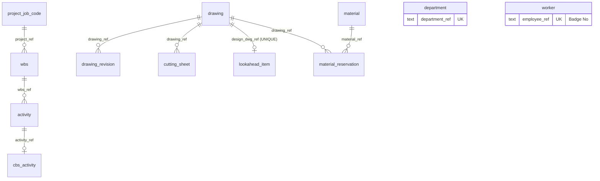
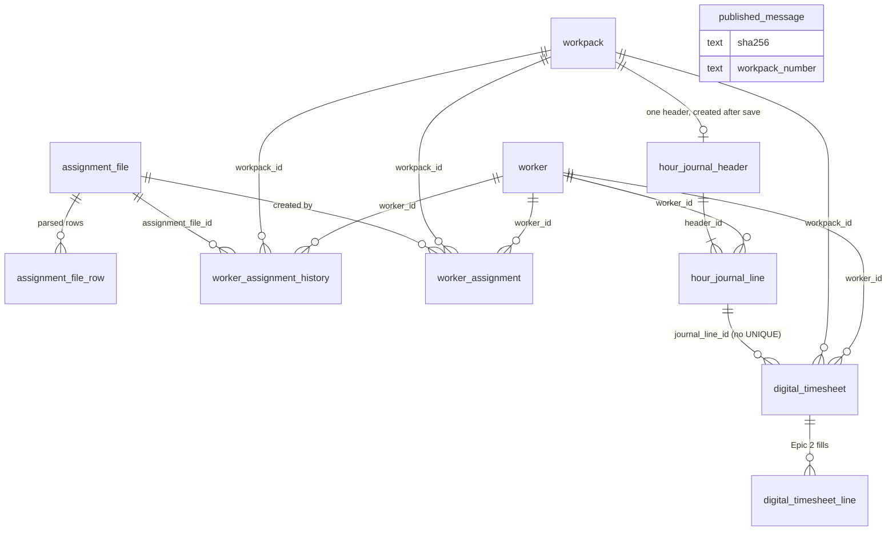
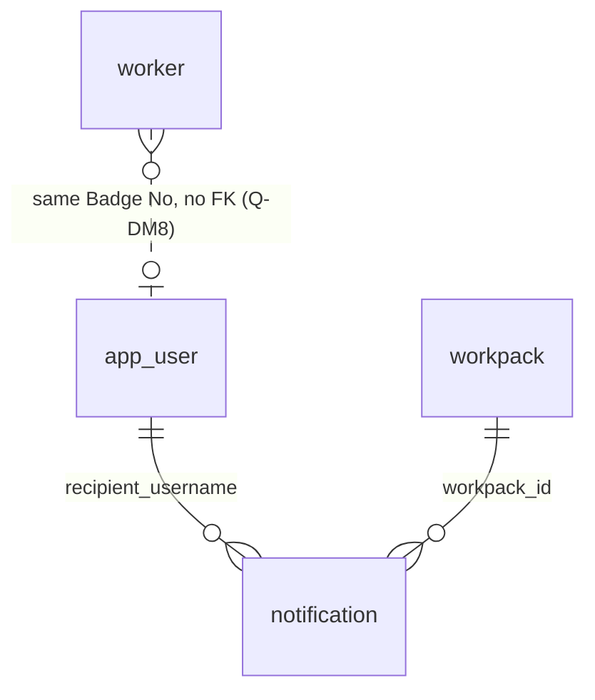

# Data model: STAR BPA POC

Status: **v0.7, approved 11 Nov 2026 (SORs: Khitaba for the PO; DDL: Ahsan), merged by BPA-48: Epic 2 tables in §13, delivered as V2.** Earlier: **v0.6, 2 Nov 2026: `user_role_scope` removed (PO decision 2 Nov 2026, BPA-44; V1 edited in PR #19).** Earlier: **v0.5, approved 29 Oct 2026; delivered as V1 under BPA-42.** Approval review of v0.4 done; every finding decided (Khitaba; Ahsan/Usama; Faraz as PO and Architect). Prepared by Claude (BA/solution designer) under Jira BPA-40. Formal approval for V1 generation: see §9.
Repo path when committed: `docs/data-model.md`. Schema: `bpa` (04-conventions).
Approval chain (09 §4 item 3): Claude drafts → **Khitaba checks SORs** → **Faraz and Ahsan/Usama approve** → **Usama generates `V1__baseline_schema.sql` and `R__seed_reference_data.sql`** (09 S17).

This is the **single** domain data model for the POC (09 S16). It is not per epic and not per story. Stories' SOR Notes reference it; Flyway only delivers it. An enterprise canonical model was considered and set aside by the PO on 28 Oct 2026; this model stays scoped to the POC (S16).

Sources, in the authority order set by D57:
1. Jira stories BPA-6 to BPA-16, BPA-22, BPA-23, BPA-26 — SOR Notes and acceptance criteria (re-read 28 Oct 2026 after the 07:34–07:37 UTC updates; re-checked 29 Oct after the approval-review edits to BPA-6, 12, 15, 16).
2. Knowledge files `03-sor-matrix.md`, `04-conventions.md`, `00-context.md`.
3. `claude/06-epic1-decisions-draft.md` (C, D1–D74), `claude/09-architecture-decisions-2026-10-27.md` (S/G/L), and the PO decisions P1–P4 of 28 Oct recorded in §0.

**Nothing here is a new business rule.** Every column, type and constraint is traced to a story or a numbered decision. Where a story left something unstated it is marked **(A)** for ASSUMPTION, or raised in §9.

---

## 0. Change log

### v0.7 (13 Nov 2026, Epic 2; Jira BPA-48)

The v0.7 delta rev. 2 (SORs approved by Khitaba for the PO and DDL approved by Ahsan, 11 Nov 2026) is merged as §13 and delivered as `V2__epic2_timesheet_to_progress.sql`. V1 is frozen because the QA dev server already runs it (Q-DM21).

| Change | Where |
| --- | --- |
| 20 new tables: Hours (5), Progress (8), cost reference copies (3), `variance_alert`, `cbs_review`, `user_project`, `worker_leave`; 30 → 50 tables | §2, §13 |
| `worker` gets `employee_id` (NOT NULL, UNIQUE, backfilled as `'EMP-' \|\| employee_ref`) and five more HR fields from FRD-5-2 §5.2.6.2 | §13.1A |
| `digital_timesheet_line` gets status, submission, file and FMS-export links, remarks; `hours >= 0`; one line per Worker, date and phase, ignoring Rejected lines | §13.1 |
| Seed: activity A-2301, `cbs_forecast`, `cbs_actual_cost`, `cbs_block`, `worker_leave`, the six Worker HR fields | §13.6, §11 |
| Test users: eleven personas; project scope returns as `user_project` (project only) | §13.7, ADR 0005 |
| Parked, not in V2: `hours_approval`, `hours_submission.approval_route`, `cbs_reopen_request` | §13 |
| Q-DM16 to Q-DM24 decided; Q-DM25 and Q-DM26 applied by BPA-48, to be confirmed in its PR | §13.Q |

### v0.6 (2 Nov 2026, PO decision; Jira BPA-44)

The POC uses only the seven personas, one login each, username equal to the Camunda group ID; access is by group only (decided by the PO; approved by Ahsan on behalf of Faraz). Delivered in PR #19, which edited V1 because no shared or showcase environment existed (09 L5).

| Change | Where |
| --- | --- |
| `user_role_scope` removed; domain F holds `app_user` only; 31 → 30 tables | §2, §2.4, §5.11, §7.1, §7.2 |
| Test fixtures write `app_user` only; BPA-16's users are `workpack-owner` and `project-engineer` | §5.10 |
| PRJ-139 and PRJ-140 stay as reference data; no scope FK depends on them | §11 |
| Departments are no longer used for access checks | §3.5 |

### v0.5 (29 Oct 2026, approval review; Jira BPA-40)

Two fresh-context reviewers checked v0.4 against all 14 stories, 03, 04, 09 and the ADRs. Decisions: Khitaba (SOR labels and business wording, approved by the PO), Ahsan (B1), Usama (the rest of the DDL and runtime items, plus N1–N4), Faraz as PO and Architect (C1–C5). Record: Claude Project `audits/data-model-v0.4-approval-2026-10-29.md`; 06 D73, D74.

| ID | Change | Where |
| --- | --- | --- |
| B1, C1 | `assignment_file_row.wp_outcome` holds the Work Pack-level "Replacement not applied"; `outcome` may be NULL only when `wp_outcome` is set (ASSUMPTION: valid rows of a Work Pack not applied keep `outcome` NULL) | §5.2, §7.3 |
| B2, B3, C2 | The sentence "G10's message ID still prevents a double publish" is removed (false at TTL 0). New table `published_message`: the duplicate guard is committed database state. A failed or uncorrelated publish deletes its claim. At-most-once publish is accepted; a transactional outbox is the production answer | §5.1, §5.12, §8 |
| B4, C3 | Upload uses Camunda's synchronous correlate call. Replacement: compare-and-set `Assigned → Replacing`, commit, correlate; revert with "Replacement already in progress" when no instance starts. D61 and the BPMN are unchanged | §8 |
| D73 (B11) | Duplicate check per `(sha256, workpackNumber)`; new row outcome "Already processed in an earlier upload"; "File already processed" only when every Work Pack in the file was published before | §5.1, §7.3, §8 |
| N1, D74 | `UNIQUE (workpack_id, phase, material_ref)`; worker message "Material <material_ref> is listed twice for phase <phase>"; **amends Q-DM4** (accepted by the PO) | §4.3, §9 |
| A4 | `workpack_material` rows matched on update by `id` carried in task variables | §4.3 |
| A1, B12, A14, N3, N4 | DB defaults and FK delete rule; `bpa-service` when no user is in context; Camunda usernames without `_ref`; deliberate snapshots and candidate keys documented | §1.1, §1.2 |
| A9, A11, A12 | One SOR label per system; per-column labels kept (row-level reason stays); look-ahead label explained | §1.3, §3–§7 |
| B5, B6, B15 | Partial unique index for synthetic rows; writer named for every outcome; `worker_name` in the result | §5.2, §7.3 |
| B7 | Test fixtures write `app_user` and `user_role_scope`; L2's "only writer" applies at runtime | §5.10, §5.11 |
| A2, A3, A5, A8, A10, A13, A15, B10, B13, B14 | Sequence named; audit-log rules; duplicate-phase check order; seed upsert; ERD; stale lines and citations | various |
| A6, A7, B8 | Tests own scenario data; the seed holds the named reference rows | §11 |
| N2 / C5 | `worker_assignment_history.source_file` **kept** (BPA-13 asserts it); documented as a snapshot (N3) | §5.4 |

### v0.4 (28 Oct 2026, PO call)

Decided by Faraz with Khitaba and Ahsan/Usama on the call; recorded in 06 as D70–D72.

| Item | Decision |
| --- | --- |
| Q-DM1, Q-DM6, Q-DM9 | Accepted as proposed (Ahsan/Usama): `text` + `CHECK`; deferred composite FK; audit-column types with `'seed'` / `'system'`. |
| Q-DM2 | Accepted as drafted (Khitaba): `department.name`, `material.description`, `drawing.title` NOT NULL; `department_ref` seeded with the readable value used in stories. |
| Q-DM5, Q-DM8, Q-DM11 | Accepted as proposed. |
| Q-DM13 (D71) | `Replacement not applied: file has rejected rows` is judged **per Work Pack**: a row outcome on that Work Pack's rows; other Work Packs in the file are unaffected. |
| Q-DM14 (D70, amends G10) | No unique constraint on `assignment_file.sha256` (indexed only). An upload is a duplicate — `File already processed` — only when an earlier upload with the same `sha256` published at least one message. Every upload gets its own `assignment_file` row. A file whose rows were routed has `outcome` NULL; its rows carry the outcomes. *(v0.5: amended per Work Pack by D73; the message-ID sentence that stood here was removed, B2.)* |
| Q-DM15 (D72) | A Worker removed by one replacement and re-added by a later one: the existing journal line is reopened (`Open`, new hours) and the time sheet reset to `Draft`, instead of inserting new rows. |

### v0.3 (28 Oct 2026)

**PO decisions taken by Faraz, 28 Oct 2026** (to be copied into 06 as D66–D69):

| # | Decision | Effect here |
| --- | --- | --- |
| **P1** | WBS: D365 F&O is the target-state holder of the WBS. It is designed to source WBS data from FMS, and an integration from D365 F&O back to FMS carries any updates. | `wbs_ref` keeps the label **D365 F&O Project Management** (C8c unchanged). The FMS → D365 feed and the D365 → FMS update flow are recorded as integration notes (§3.2). Shape unchanged. *Reading confirmed by the PO, 28 Oct.* |
| **P2** | Upload while `assignment_state = Replacing` → **"Replacement already in progress"** (BPA-13 wording). Upload while `Assigning` → "Assignment still in progress; try again later" (unchanged). | Closes Q-DM12. Both strings are **row** outcomes (§7.3). BPA-12 outline row and the D61 text in 06 to be corrected (§10.2). |
| **P3** | The superseded revision shown in the BPA-16 email travels as the process variable `supersededRevision` from the `DrawingRevised` message to `SendTask_NotifyRecipients`. **Not stored.** | Closes Q-DM7. No column added to `drawing_revision`. |
| **P4** | Drop `workpack.created_by`; the audit column `created_by` holds the same Camunda username. | Closes Q-DM3. BPA-6 SOR Notes to be amended (§10.2). |

**Defects fixed (no rule change):**

| # | Defect in v0.2 | Fix |
| --- | --- | --- |
| F1 | `assignment_file_row.row_number` NOT NULL made BPA-13 scenario 2 untestable: the result must show E1099 "Hours loaded; not removed", but E1099 is **not a row in the file**, and the result is rebuilt only from `assignment_file_row` (D49). | `row_number` nullable; `replace-worker-assignment` writes one **synthetic row** (row_number NULL) per removed Worker kept because hours are loaded. §5.2. **(A)** |
| ~~F2~~ | *Withdrawn after QA.* The draft "fixed" §3.8's rule "latest revision not Superseded" as unsourced. It is sourced: BPA-8 SOR Notes define `drawingApproved` on "the latest revision (by registered_at) that is not Superseded". | v0.2 text restored; both definitions now cited separately (§3.8). |
| F3 | `worker_assignment_history.worker_assignment_id` FK with `ON DELETE SET NULL` (Q-DM10) — loses the identifier the history exists to keep. | Plain `uuid NOT NULL`, **no FK**: a historical identifier, the same pattern as `audit_log.record_id`. Closes Q-DM10. Deleting a removed Worker's `worker_assignment` row is itself **(A)** — BPA-13 says only "no longer assigned" — and re-adding that Worker later is Q-DM15. |
| F4 | Q-DM2 called `department`, `material`, `drawing` "required by stories but defined by none". | They are also required by **locked decision S20** (reference lists `GET departments`, `drawings`, `materials`) and named in BPA-6 / BPA-16 backgrounds. Tables are now sourced; only their non-key columns stay **(A)**. |
| F5 | `cbs_activity` grain unstated (Q-DM4). | BPA-15 derives **one** `cbs_code_ref` per time sheet from the activity, which only works if an activity has at most one CBS code. `UNIQUE(activity_ref)` added, marked derived **(A)**. |
| F6 | `remarks varchar(250)` vs BPA-22 "`remarks text` max 250". | `text` + `CHECK (char_length(remarks) <= 250)`, consistent with Q-DM1. |
| F7 | §1.3 did not say what SOR a `uuid` foreign key carries; v0.2 labelled `worker_id` myPeople but `workpack_id` POC database without a rule. | Rule made explicit (§1.3): a uuid FK carries the SOR of the entity it identifies — as BPA-14, BPA-15 and BPA-22 state for `worker_id`. No label changed. |
| F8 | Wrong cross-references: §1.2 pointed to `audit_log` at §6.3 (it is §6.1); §1.4 put open questions in §8 (they are §9); §8 pointed to "§9" for the BPA-15 issue (it is §10.2); §10.3 said "(A)" columns are collected in §11 (§11 is seed sizing). | Corrected. |
| F9 | `assignment_file` SOR reason cited "D33 rule 12", which 06 retires (D58 keep-list and the 06 "Superseded" paragraph) while BPA-12 still cites it. | Reason now cites D49, D58 and BPA-12. Contradiction logged in §10.1. |
| F10 | §4.4 put the lead-time rule on `planned_start_date` only. BPA-11's outline rejects **planned end** 27 Oct with "Date cannot be earlier than 28 Oct 2026". | Both planned dates worker-checked against today + lead time (§4.4). |
| F11 | `audit_log` old/new value format unstated; a plain cast of `numeric(7,2)` gives `250.00`, BPA-23 asserts `250`. | Canonical text format defined (§6.1). |
| F12 | History idempotency key used `source_file` (a file name, not unique), so a second replacement under the same name would lose rows. | `assignment_file_id` added to `worker_assignment_history`; key uses it (§5.4). |
| F13 | Composite FK (Q-DM6) would break BPA-23 corrections done by delete-and-insert, and delete-and-insert would also break the BPA-23 audit row. | Phases and materials updated in place; FK `DEFERRABLE INITIALLY DEFERRED` (§4.2, §4.3). |
| F14 | `lookahead_item` had no key though BPA-11 reads "the Look-Ahead row" for a drawing. | `UNIQUE(design_dwg_ref)` **(A)** (§3.11). |
| F15 | `text` `_ref` FKs labelled inconsistently (`lookahead_item.design_dwg_ref` PCON vs `cutting_sheet.drawing_ref` Document Control); §7.2 omitted `app_user`. | §1.3 rule extended to `_ref` FKs; relabelled; §7.2 corrected. |
| F16 | `decline_reason` CHECK accepted an empty or blank string. | `btrim(decline_reason) <> ''` (§4.6). |
| F17 | ERD cardinalities inconsistent (header `o|` vs `||`; file → rows `|{` though a file may have no rows). | Aligned. |

**Found by the v0.3 QA pass, raised rather than fixed** (they need a rule): Q-DM14 (duplicate-file rule vs "resend the file"), Q-DM15 (re-adding a removed Worker), and the file success outcome (in Q-DM14).

**Recommendations applied as PROPOSED** (the approver named in §9 confirms in the approval chain; nothing below is a business rule): Q-DM1 `text` + `CHECK`; Q-DM5 inactive worker is a no-op; Q-DM6 composite FK; Q-DM8 no FK; Q-DM9 audit types and `'seed'`; Q-DM11 `app_user` outside `audit_log`.

### v0.2 (28 Oct 2026)
Sceptical QA pass against the Jira stories and the decision logs; 17 defects in v0.1 fixed or raised.

---

## 1. How to read this document

### 1.1 Conventions applied (04-conventions)

| Rule | Applied as |
| --- | --- |
| Schema | `bpa` |
| Table names | snake_case, singular |
| Primary key | `id uuid` — **one exception**, `app_user`, keyed by `username` (D63) |
| Columns holding another system's identifier | end in `_ref`, hold that system's ID as text |
| Audit columns on every table | `created_at`, `created_by`, `updated_at`, `updated_by` |
| Timestamps | `timestamptz`, stored UTC (09 S9) |
| Business dates | `date`, evaluated in **Asia/Riyadh** by the application clock, never by the database (09 S9, D28) |
| Enumerations | `text` + `CHECK (col IN (…))` (Q-DM1, decided 28 Oct) |
| Defaults (A1) | `id uuid DEFAULT gen_random_uuid()`; `created_at`, `updated_at` `DEFAULT now()` |
| Foreign keys (A1) | every FK `ON DELETE NO ACTION` (rows are deleted explicitly by the worker that owns them) |
| Camunda usernames (A14) | `scheduled_by`, `signed_off_by`, `uploaded_by`, `recipient_username`, `username`, `created_by`, `updated_by` hold Camunda usernames and carry **no** `_ref` suffix, as the stories name them; recorded for 04-conventions under L16 |

**Candidate keys (N4).** Every table has `id uuid` (04-conventions). Where a table also has a UNIQUE constraint, that UNIQUE is the real candidate key and the business key the workers use: `workpack_schedule(workpack_id)`, `workpack_print(workpack_id)`, `hour_journal_header(workpack_id)`, `cbs_activity(activity_ref)` and the others marked UNIQUE in §3–§6.

**Deliberate snapshots (N3).** The model is in 3NF except for these copies, each kept on purpose and traced to a story:
- `digital_timesheet.project_ref`, `wbs_ref`, `activity_ref` — the time sheet keeps the coding it was issued with (§5.7; BPA-15). `project_ref` is also reachable through `wbs_ref`.
- `hour_journal_line.role`, `designation` — copied at creation, never refreshed (§5.6; BPA-14).
- `assignment_file_row` raw text columns — the file as uploaded, including invalid values (§5.2; BPA-12, BPA-22).
- `worker_assignment_history.source_file` — the file name as shown in history; derivable from `assignment_file_id`, kept because BPA-13 names and asserts it (§5.4; PO, 29 Oct, C5).

### 1.2 Audit columns (Q-DM9, decided 28 Oct)

Every table in §3–§6 carries these four; they are **not repeated** in the column tables.

| Column | Type | Null | Note |
| --- | --- | --- | --- |
| `created_at` | `timestamptz` | NOT NULL | UTC |
| `created_by` | `text` | NOT NULL | Camunda username (D63) of the user whose action wrote the row (for a save worker, the user who completed the task); `bpa-service` (S25) when a job worker writes with no user in context (B12); literal `'seed'` for rows written by `R__seed_reference_data.sql`; `'system'` for the S22 start-up job |
| `updated_at` | `timestamptz` | NOT NULL | UTC; default `now()`, so it equals `created_at` on insert; set by the writer on update |
| `updated_by` | `text` | NOT NULL | as `created_by` |

`04-conventions.md` names the four columns only; types, nullability and the seed value are decided here (Q-DM9) and go into 04 with the L16 update (Ahsan).

`audit_log` (§6.1) is the only table **without** these four, because it is itself the audit record (D64).

### 1.3 The SOR column

Every field has exactly one SOR. The SOR column names:
- **POC database** — the POC owns the value. A reason is given on every such table, as the project rules require.
- **A real system** (D365 F&O, FMS, myPeople, P6, Camunda) — the value is a **seeded copy**, labelled with the system that owns it after go-live. Each such table carries `COMMENT ON TABLE` naming the SOR (09 S17).

**Surrogate keys.** `id uuid` primary keys have no SOR: POC-internal row identifiers that exist only because 04-conventions requires them and are never exchanged with another system. Shown as `—`.

**Foreign keys** (F7, F15). A column pointing at another table — a `uuid` to its `id` or a `text` `_ref` to its business key — carries the SOR of **the entity it identifies**, as the stories state it: `worker_id` → myPeople (BPA-14, BPA-15, BPA-22); `workpack_id`, `header_id`, `journal_line_id` → POC database; any `drawing_ref` → D365 F&O Document Control.

**Rows and columns (A11, Khitaba, approved by the PO 29 Oct).** The rule above applies to every table, including those whose rows the POC owns. A table's **SOR reason** line says why the POC holds the *row*; the SOR column says who owns each *value*. Jira BPA-15 and BPA-16 SOR Notes and the 09 change log were aligned to this on 29 Oct.

**Canonical labels (A9).** The SOR cell starts with exactly one of these labels; `COMMENT ON TABLE` / `COMMENT ON COLUMN` and the S17 CI test use the label only. Anything after the label (in brackets or after a dash) is a note, not part of the label.

| Label | Used for |
| --- | --- |
| `POC database` | values the POC owns |
| `Camunda identity` | usernames and group IDs |
| `myPeople` | Worker identity and attributes |
| `D365 F&O Project Management` | project, WBS |
| `D365 F&O Document Control` | drawings and revisions |
| `D365 F&O Product Information Management` | material master |
| `D365 F&O PPC` | material reservation (Traceability Number) |
| `D365 F&O Cost Control Report` | CBS code |
| `D365 F&O Finance` | actual cost per CBS and month (`cbs_actual_cost.actual_cost`; v0.7) |
| `D365 F&O Project Control (PCON)` | Look-Ahead plan dates |
| `D365 F&O Organisation` | department |
| `FMS` | Job Code, cutting sheet |
| `P6 via D365 PMS` | activity and its plan fields |
| `Corporate email system` | `app_user.email` (ASSUMPTION) |

### 1.4 Markers used in the column tables

| Marker | Meaning |
| --- | --- |
| **(A)** | ASSUMPTION — no story or decision states this; I inferred it |
| **worker-checked** | enforced by a job worker, not by the database (see §1.5) |
| **Q-DM*n*** | an item in §9 |
| **P*n*** | a PO decision of 28 Oct (§0) |

### 1.5 Rules the database cannot hold

Three categories of rule in the stories are **not** expressible as PostgreSQL constraints, and are listed as worker-checked rather than in the Constraint column:

1. **Rules referencing "today"** — `completion_date` not in the past (D20); `planned_start_date` and `planned_end_date` `>= today + lead_time_days` (D9, BPA-11). `CHECK` cannot call a non-`IMMUTABLE` function, and the clock is injected (09 S9).
2. **Rules referencing application config** — anything using `lead_time_days`, which is config, not data (§6.2).
3. **Cross-row and cross-table rules** — "every `workpack_material` has a reservation" (BPA-8).

All of these throw `WORKPACK_INVALID` or `SCHEDULE_INVALID` from the save worker, returning `validationMessages` (D56, 09 S14).

### 1.6 Group names

The seven Camunda groups (09 S6, BPA-25): `time-method-analyst`, `project-engineer`, `production-planner`, `workpack-owner`, `ppc-team`, `supervisor`, `production-team`. **From v0.7 eleven:** the same seven plus `timekeeper`, `production-supervisor`, `cost-controller`, `project-manager` (E2-D1; §13).

---

## 2. Domain map

Six domains (09 S16), plus one cross-cutting audit table. **30 tables** through v0.6 (v0.5 added `published_message`; v0.6 removed `user_role_scope`); **50 from v0.7** (V2 adds 20, listed in §13.0). The table below is the v0.6 map; the Epic 2 tables and their domains (A cost copies, D hours, E `variance_alert`, H progress and review, access scope and leave) are in §13.

| # | Domain | Tables | Count | SOR |
| --- | --- | --- | --- | --- |
| A | Reference data copies | `project_job_code`, `wbs`, `activity`, `cbs_activity`, `department`, `material`, `drawing`, `drawing_revision`, `material_reservation`, `cutting_sheet`, `lookahead_item`, `worker` | 12 | Real systems (copies) |
| B | Work Pack | `workpack`, `workpack_phase`, `workpack_material`, `workpack_schedule`, `workpack_print`, `release_signoff` | 6 | POC database |
| C | Assignment | `assignment_file`, `assignment_file_row`, `worker_assignment`, `worker_assignment_history`, `published_message` | 5 | POC database |
| D | Hours | `hour_journal_header`, `hour_journal_line`, `digital_timesheet`, `digital_timesheet_line` | 4 | POC database |
| E | Notification | `notification` | 1 | POC database |
| F | App user | `app_user` | 1 | POC database (the row); columns per §1.3: Camunda identity, myPeople, corporate email |
| G | Audit | `audit_log` | 1 | POC database |

### 2.1 ERD — the Work Pack spine

### 2.2 ERD — reference data copies (domain A)

### 2.3 ERD — assignment and hours (domains C, D)

`worker_assignment_history.worker_assignment_id` is deliberately **not** drawn: it has no FK (F3). `published_message` has no FKs (§5.12).

### 2.4 ERD — app user and notification (domains E, F)

---

## 3. Domain A — reference data copies

All seeded by `R__seed_reference_data.sql` (09 S17, L2). None is written at runtime, with one exception: `drawing_revision` is seeded and then also written by the drawing-revisions endpoint from D365 events (D45, D53, G6).

**Seed reloads (A8).** Flyway re-runs the repeatable seed whenever its checksum changes. It therefore **upserts on each table's business key** (`INSERT … ON CONFLICT (<key>) DO UPDATE`), never deletes, and never touches `drawing_revision` rows that are not in the seed (rows written at runtime from events).

### 3.1 `project_job_code`

| Column | Type | Null | Constraint | SOR | Source |
| --- | --- | --- | --- | --- | --- |
| `id` | `uuid` | NOT NULL | PK | — (§1.3) | 04-conventions |
| `project_ref` | `text` | NOT NULL | **UNIQUE** | D365 F&O Project Management | BPA-6; C8a |
| `job_code_ref` | `text` | NOT NULL **(A)** | | FMS (created by the PCON Planner) | BPA-6; C8b |

`UNIQUE(project_ref)` enforces "one Job Code per project" — **ASSUMPTION** (D13). Two SORs in one table is deliberate; each *column* still has exactly one. Needs a column comment (§7.2).

### 3.2 `wbs`

| Column | Type | Null | Constraint | SOR | Source |
| --- | --- | --- | --- | --- | --- |
| `id` | `uuid` | NOT NULL | PK | — | |
| `wbs_ref` | `text` | NOT NULL | UNIQUE | D365 F&O Project Management | BPA-6; C8c; **P1** |
| `project_ref` | `text` | NOT NULL **(A)** | FK → `project_job_code(project_ref)` | D365 F&O Project Management | BPA-6; C8a |

**Integration note (P1, PO 28 Oct).** In the target landscape D365 F&O sources WBS data from FMS, and a D365 F&O → FMS integration carries updates. The POC holds a seeded copy and implements neither flow; if made live, the FMS side is batch/file (project rule for partner-side integrations). The FRD conflict behind C8c (FRD-7 §7.4, §7.6 s1 name FMS) stays recorded; STAR question 2 stays open.

### 3.3 `activity`

| Column | Type | Null | Constraint | SOR | Source |
| --- | --- | --- | --- | --- | --- |
| `id` | `uuid` | NOT NULL | PK | — | |
| `activity_ref` | `text` | NOT NULL | UNIQUE | P6 via D365 PMS | BPA-6; C13 |
| `activity_name` | `text` | NOT NULL **(A)** | | P6 via D365 PMS | BPA-6; C13 |
| `wbs_ref` | `text` | NOT NULL **(A)** | FK → `wbs(wbs_ref)` | D365 F&O Project Management | BPA-6; C8c |
| `fac_crpo` | `text` | NULL | | P6 via D365 PMS — **contradicted**: FRD-10 §10.8.1 calls it a D365-only field (C13) | BPA-6 |
| `fac_type` | `text` | NULL | | P6 via D365 PMS | BPA-6 |
| `fac_name` | `text` | NULL | | P6 via D365 PMS | BPA-6 |
| `discipline` | `text` | NULL | | P6 via D365 PMS | BPA-6 |
| `baseline_start` | `date` | NULL | | P6 via D365 PMS | BPA-6 |
| `baseline_end` | `date` | NULL | | P6 via D365 PMS | BPA-6 |
| `budgeted_units` | `numeric(9,2)` | NULL | | P6 via D365 PMS | BPA-6 |

The last seven are nullable on evidence: BPA-6 has an activity with no plan data (A-2299) and the Work Pack is still created. Nothing is validated against them (D17). Needs a column comment — `wbs_ref` has a different SOR from the table.

### 3.4 `cbs_activity`

| Column | Type | Null | Constraint | SOR | Source |
| --- | --- | --- | --- | --- | --- |
| `id` | `uuid` | NOT NULL | PK | — | |
| `activity_ref` | `text` | NOT NULL **(A)** | FK → `activity(activity_ref)`; **UNIQUE** (derived **(A)**, F5) | P6 via D365 PMS | BPA-15 |
| `cbs_code_ref` | `text` | NOT NULL **(A)** | | D365 F&O Cost Control Report | BPA-15; D40 |

`UNIQUE(activity_ref)`: BPA-15 derives a single `cbs_code_ref` per time sheet from the activity, so an activity has at most one CBS code. An activity with **no** row gives a blank CBS (BPA-15, A-2299).

### 3.5 `department` — sourced table, non-key columns ASSUMPTION (Q-DM2)

| Column | Type | Null | Constraint | SOR | Source |
| --- | --- | --- | --- | --- | --- |
| `id` | `uuid` | NOT NULL | PK | — | |
| `department_ref` | `text` | NOT NULL | UNIQUE | D365 F&O Organisation (financial dimension) | BPA-6; D18; 09 S20 |
| `name` | `text` | NOT NULL **(A)** | | D365 F&O Organisation | **(A)** |

Required by BPA-6 (option list; background "department Fabrication"), the `workpack.department_ref` FK and the locked `GET /api/v1/departments` (S20). Stories refer to departments by a readable value ("Fabrication", "Painting"); whether that value is the `department_ref` or the `name` is a seed choice — **(A)**: seed `department_ref` = the readable value, so story data works unchanged.

### 3.6 `material` — sourced table, non-key columns ASSUMPTION (Q-DM2)

| Column | Type | Null | Constraint | SOR | Source |
| --- | --- | --- | --- | --- | --- |
| `id` | `uuid` | NOT NULL | PK | — | |
| `material_ref` | `text` | NOT NULL | UNIQUE | D365 F&O Product Information Management | BPA-6; C12, D54; 09 S20 |
| `description` | `text` | NOT NULL **(A)** | | D365 F&O Product Information Management | **(A)** |

### 3.7 `drawing` — sourced table, non-key columns ASSUMPTION (Q-DM2)

| Column | Type | Null | Constraint | SOR | Source |
| --- | --- | --- | --- | --- | --- |
| `id` | `uuid` | NOT NULL | PK | — | |
| `drawing_ref` | `text` | NOT NULL | UNIQUE | D365 F&O Document Control | BPA-6, BPA-16; C15; 09 S20 |
| `title` | `text` | NOT NULL **(A)** | | D365 F&O Document Control | **(A)** |

Required by BPA-16: `POST /api/v1/drawing-revisions` returns **404 `Drawing not found`** for an unknown drawing, which only works if drawings exist independently of their revisions (G6).

### 3.8 `drawing_revision`

| Column | Type | Null | Constraint | SOR | Source |
| --- | --- | --- | --- | --- | --- |
| `id` | `uuid` | NOT NULL | PK | — | |
| `drawing_ref` | `text` | NOT NULL | FK → `drawing(drawing_ref)`; **UNIQUE(drawing_ref, revision)** | D365 F&O Document Control | BPA-8, BPA-16; C15 |
| `revision` | `text` | NOT NULL | part of the unique key | D365 F&O Document Control | BPA-16; D42 |
| `status` | enum (§7.1) `[IFR, IFA, IFI, IFC, As-Built, Superseded]` | NOT NULL | | D365 F&O Document Control | BPA-8, BPA-16; D23, D60 |
| `registered_at` | `timestamptz` | NOT NULL | | D365 F&O Document Control | BPA-16; D42 |

- **Read-only copy.** Seeded; at runtime written only by the drawing-revisions endpoint from a `DrawingRevised` event (D41, D45, D53). G6 phrases this as the API "marking the previous revision Superseded"; per D53 it applies only what the event reports.
- `revision` is **opaque text** — the POC never parses or orders the label (D42). Two definitions are in use, both sourced:
  - **Latest revision** (BPA-16, D42): most recent `registered_at`.
  - **Approval check** (BPA-8 SOR Notes, `drawingApproved`): status of the latest revision by `registered_at` **that is not Superseded** is IFC or As-Built.
  They give the same answer whenever the newest row is not Superseded, which is every seeded and story case; they differ only if D365 ever reported the newest revision as Superseded.
- `Superseded` is applied only as the event's `supersededRevision` reports it; the POC never decides it (D45, D53). If the event names no superseded revision, or one not in the copy (BPA-16 `Z9`), nothing is marked and, for `Z9`, a warning is logged.
- Approved = `IFC` or `As-Built` (D10, unchanged by D60). A drawing with **no** revision row gives `drawingApproved = false` (BPA-8, ASSUMPTION).
- **`supersededRevision` is not stored** (P3). It travels as a process variable from the `DrawingRevised` message to `SendTask_NotifyRecipients`, which prints it as "previous revision" in the email. When absent, the email's previous-revision field is blank **(A)**.

### 3.9 `material_reservation`

| Column | Type | Null | Constraint | SOR | Source |
| --- | --- | --- | --- | --- | --- |
| `id` | `uuid` | NOT NULL | PK | — | |
| `traceability_number` | `text` | NOT NULL **(A)** | | D365 F&O PPC | BPA-8; C12, D54 |
| `drawing_ref` | `text` | NOT NULL **(A)** | FK → `drawing(drawing_ref)` | D365 F&O Document Control | BPA-8; C5 |
| `material_ref` | `text` | NOT NULL **(A)** | FK → `material(material_ref)` | D365 F&O Product Information Management | BPA-8; C12 |

Reservations are keyed by **drawing + material** (C5), not by Work Pack. `materialsReserved` is true when every `workpack_material` has a reservation for `(workpack.drawing_ref, material_ref)` — worker-checked, cross-table (BPA-8). Three different D365 modules appear here; all three columns need comments.

### 3.10 `cutting_sheet`

| Column | Type | Null | Constraint | SOR | Source |
| --- | --- | --- | --- | --- | --- |
| `id` | `uuid` | NOT NULL | PK | — | |
| `cutting_sheet_ref` | `text` | NOT NULL **(A)** | | FMS (nesting) | BPA-10; D30 |
| `drawing_ref` | `text` | NOT NULL **(A)** | FK → `drawing(drawing_ref)` | D365 F&O Document Control | BPA-10; D30 |

Linked **by drawing**, not by Work Pack — the key and the empty case are ASSUMPTION (D30). No cutting sheet → the print shows `No cutting sheet available`.

### 3.11 `lookahead_item`

| Column | Type | Null | Constraint | SOR | Source |
| --- | --- | --- | --- | --- | --- |
| `id` | `uuid` | NOT NULL | PK | — | |
| `design_dwg_ref` | `text` | NOT NULL **(A)** | FK → `drawing(drawing_ref)`; **UNIQUE** **(A)** (F14) | D365 F&O Document Control (§1.3) | BPA-11; D48 |
| `shop_drg_mark_plan_date` | `date` | NULL | | D365 F&O Project Control (PCON) | BPA-11; D48 |
| `assembly_plan_date` | `date` | NULL | | D365 F&O Project Control (PCON) | BPA-11; D48 |
| `weld_map_plan_date` | `date` | NULL | | D365 F&O Project Control (PCON) | BPA-11; D48 |

**Labels (A12, Khitaba, approved by the PO 29 Oct).** 03-sor-matrix and BPA-11 label the Look-Ahead *entity* PCON, which is right for the plan dates. `design_dwg_ref` identifies a drawing, so under §1.3 it carries Document Control; drawing numbers have one SOR across the model.
Matching key: **Design Dwgs = the Work Pack's drawing** (BPA-11). One row per drawing, because BPA-11 reads "the Look-Ahead row for DWG-118". No row → `No Look-Ahead plan dates for <drawing>` and scheduling proceeds. Read-only labels: Shop Drg Mark, Assembly / Integration, Weld Map Drawing. L8's "3 weeks per project" is met by spreading the seeded plan dates over three weeks; there is no week or project column.

### 3.12 `worker`

| Column | Type | Null | Constraint | SOR | Source |
| --- | --- | --- | --- | --- | --- |
| `id` | `uuid` | NOT NULL | PK | — | |
| `employee_ref` | `text` | NOT NULL | **UNIQUE** | myPeople | BPA-22; C1, C11, C14, **C17** |
| `name` | `text` | NOT NULL **(A)** | | myPeople | BPA-22; C14 |
| `role` | `text` | NOT NULL **(A)** | | myPeople | BPA-22, BPA-14 |
| `designation` | `text` | NOT NULL **(A)** | | myPeople | BPA-22, BPA-14 |
| `agency_flag` | `boolean` | **NOT NULL** (stated) | | myPeople (the agency tag) | BPA-22; C11 — **ASSUMPTION**, field name and values unconfirmed (STAR question 7) |
| `cost_centre_ref` | `text` | NULL | | myPeople — **ASSUMPTION** that myPeople carries it; the code values are D365 financial-dimension codes, which does not change the SOR | BPA-15; D40 |

- `employee_ref` **holds the Badge No** (D59). Contradiction C17 is recorded in §10.1. Stories label it "Employee ID" on screen (BPA-15); the value is the Badge No.
- Worker **active status is not checked** in the POC (BPA-22, ASSUMPTION), so no `active` column exists (Q-DM5).

---

## 4. Domain B — Work Pack

### 4.1 `workpack`

| Column | Type | Null | Constraint | SOR | Source |
| --- | --- | --- | --- | --- | --- |
| `id` | `uuid` | NOT NULL | PK | — | |
| `workpack_number` | `text` | NOT NULL | **UNIQUE**; `CHECK (workpack_number ~ '^WP-[0-9]{6}$')` | POC database (real SOR FMS, D47) | BPA-6; D15 |
| `activity_ref` | `text` | NOT NULL | FK → `activity(activity_ref)` | P6 via D365 PMS | BPA-6; C13 |
| `drawing_ref` | `text` | NOT NULL | FK → `drawing(drawing_ref)` | D365 F&O Document Control | BPA-6; C15 |
| `department_ref` | `text` | NOT NULL | FK → `department(department_ref)` | D365 F&O Organisation | BPA-6; D18 |
| `completion_date` | `date` | NOT NULL | **worker-checked**: not before today, Asia/Riyadh | POC database (C2) | BPA-6; D20, D28 |
| `status` | enum (§7.1) `[Draft, Released, In Progress, Completed]` | NOT NULL | default `Draft` **(A)** | POC database (C2) | BPA-6, BPA-9 |
| `assignment_state` | enum (§7.1) `[AwaitingFile, Assigning, Assigned, Replacing]` | **NULL** until the print is stored (stated) | | POC database | BPA-10, BPA-12, BPA-13; **D61** |
| `process_instance_key` | `bigint` | NOT NULL | **UNIQUE** | POC database — re-run key | BPA-6; D65 |

**SOR reason:** the POC plays FMS's role for Work Packs. Real SOR FMS, copied to D365 via Int-4.1 (C2, D47). Batch/file if made live.

Notes:
- `workpack_number` is generated, read-only, gaps allowed (D15, ASSUMPTION). Generator (A2): `CREATE SEQUENCE bpa.workpack_number_seq MAXVALUE 999999 NO CYCLE` (so `lpad` never truncates); `save-workpack` formats `'WP-' || lpad(nextval('bpa.workpack_number_seq')::text, 6, '0')`. A rolled-back save leaves a gap, which D15 allows. The format `CHECK` is safe because the POC generates every value.
- **No `created_by` business column** (P4): the creator is the audit `created_by`, the Camunda username (D63).
- `process_instance_key UNIQUE` is what makes `save-workpack` idempotent on retry (D65, 09 S7).
- **No `project_ref` column.** A Work Pack's project is derived from its activity (BPA-16, C8a); storing it would create a second copy of one value.

### 4.2 `workpack_phase`

| Column | Type | Null | Constraint | SOR | Source |
| --- | --- | --- | --- | --- | --- |
| `id` | `uuid` | NOT NULL | PK | — | |
| `workpack_id` | `uuid` | NOT NULL | FK → `workpack(id)`; **UNIQUE(workpack_id, phase)** | POC database | BPA-6 |
| `phase` | enum (§7.1) `[Engineering, Cutting, Welding, Finishing]` | NOT NULL | part of the unique key | POC database | BPA-6; FRD-7 §7.4 |
| `manhours` | `numeric(7,2)` | NOT NULL | `CHECK (manhours > 0 AND manhours <= 99999.99)` | POC database | BPA-6; **D14** |

**SOR reason:** part of the Work Pack, which the POC masters (C2, D47).
**Corrections update rows in place** (F13): `save-workpack` on a BPA-23 correction updates an existing `(workpack_id, phase)` row, inserts new phases, and deletes only phases no longer selected. Delete-and-reinsert would change `id` and break the BPA-23 audit row (old value 250 → new 300 on the same record).
`save-workpack` checks for a duplicate phase first and throws `WORKPACK_INVALID` with `Phase Cutting is listed twice` (BPA-6; D56); `UNIQUE(workpack_id, phase)` is the backstop, not the source of the message (A5). Boundaries proven in BPA-6: 0 rejected, 0.01 accepted, 0.001 rejected (2 dp), 99999.99 accepted, 100000 rejected. The worker checks the 2-decimal rule before saving so the message is exact; `numeric(7,2)` would otherwise round silently.

### 4.3 `workpack_material`

| Column | Type | Null | Constraint | SOR | Source |
| --- | --- | --- | --- | --- | --- |
| `id` | `uuid` | NOT NULL | PK | — | |
| `workpack_id` | `uuid` | NOT NULL | FK → `workpack(id)`; part of the composite FK below | POC database | BPA-6 |
| `material_ref` | `text` | NOT NULL | FK → `material(material_ref)`; part of **UNIQUE (workpack_id, phase, material_ref)** (N1) | D365 F&O Product Information Management | BPA-6; C12; D74 |
| `phase` | enum (§7.1) | NOT NULL | composite FK `(workpack_id, phase)` → `workpack_phase(workpack_id, phase)` `DEFERRABLE INITIALLY DEFERRED` (Q-DM6, decided 28 Oct) | POC database | BPA-6; **D16** |

**SOR reason:** part of the Work Pack, which the POC masters (C2, D47).
The composite FK is defence in depth; `save-workpack` still checks D16 first so the user sees `Phase Finishing is not selected for this Work Pack` rather than a constraint violation (D56). It is **deferred to commit** (F13) so a correction that moves materials and removes a phase in one save does not depend on statement order.

**Candidate key (N1, D74; accepted by the PO 29 Oct, amends Q-DM4).** `UNIQUE (workpack_id, phase, material_ref) DEFERRABLE INITIALLY DEFERRED` **(A: deferred for the same statement-order reason as the composite FK, F13)**. A material may appear in several phases of a Work Pack but only once per phase. `save-workpack` checks first and throws `WORKPACK_INVALID` with `Material <material_ref> is listed twice for phase <phase>`, e.g. `Material MAT-PIPE-06 is listed twice for phase Cutting` (ASSUMPTION wording, BPA-6); the constraint is the backstop.

**Updates in place (A4, F13).** Rows are matched by `id`, carried in the task variables: the React screen round-trips each material line's `id`. The worker updates lines that arrive with an `id`, inserts those without one, and deletes the Work Pack's other lines. `id` joins the S14 per-task variable allow-list (§6.3).

### 4.4 `workpack_schedule`

| Column | Type | Null | Constraint | SOR | Source |
| --- | --- | --- | --- | --- | --- |
| `id` | `uuid` | NOT NULL | PK | — | |
| `workpack_id` | `uuid` | NOT NULL | **UNIQUE**; FK → `workpack(id)` | POC database | BPA-11; D27, D65 |
| `planned_start_date` | `date` | NOT NULL | **worker-checked**: `>= today + lead_time_days`, Asia/Riyadh | POC database | BPA-11; D9, D28 |
| `planned_end_date` | `date` | NOT NULL | `CHECK (planned_end_date >= planned_start_date)`; **worker-checked**: `>= today + lead_time_days`, Asia/Riyadh (F10) | POC database | BPA-11; D9 |
| `scheduled_by` | `text` | NOT NULL | Camunda username | Camunda identity | BPA-11; D63 |

**SOR reason:** schedule of a POC-mastered Work Pack (C2).
`UNIQUE(workpack_id)` carries **D27, no rescheduling**. The lead-time rule applies to **both** dates (BPA-11 outline: planned start 27 Oct rejected, 28 Oct accepted, planned end 27 Oct rejected, each "Date cannot be earlier than 28 Oct 2026"). The worker checks lead time before end ≥ start, so a planned end of 27 Oct gets the lead-time message. Planned end after `completion_date` is **allowed** with a non-blocking notice (D26); equal dates give no notice. `scheduled_by` is kept (unlike P4) because BPA-11 asserts on it and it is not always the row's creator.

### 4.5 `workpack_print`

| Column | Type | Null | Constraint | SOR | Source |
| --- | --- | --- | --- | --- | --- |
| `id` | `uuid` | NOT NULL | PK | — | |
| `workpack_id` | `uuid` | NOT NULL | **UNIQUE**; FK → `workpack(id)` | POC database | BPA-10; D29 |
| `file` | `bytea` | NOT NULL | the PDF | POC database | BPA-10; D29 |
| `sha256` | `text` | NOT NULL | unchanged on a re-run | POC database | BPA-10; 09 S1 |
| `generated_at` | `timestamptz` | NOT NULL | | POC database | BPA-10 |

**SOR reason:** record of the print issued to the shop floor (FRD-7 §7.3.3 audit trail).
The stable `sha256` on re-run is achievable only because the PDF's creation date comes from the injected clock (09 S1).

### 4.6 `release_signoff`

| Column | Type | Null | Constraint | SOR | Source |
| --- | --- | --- | --- | --- | --- |
| `id` | `uuid` | NOT NULL | PK | — | |
| `workpack_id` | `uuid` | NOT NULL | FK → `workpack(id)` | POC database | BPA-9 |
| `task_key` | `bigint` | NOT NULL | **UNIQUE** — re-run key | POC database | BPA-9; D65, 09 S7 |
| `decision` | enum (§7.1) `[Approved, Declined]` | NOT NULL | | POC database | BPA-9 |
| `decline_reason` | `text` | NULL | `CHECK (decision <> 'Declined' OR btrim(coalesce(decline_reason, '')) <> '')` (F16) | POC database | BPA-9; D3 |
| `signed_off_by` | `text` | NOT NULL | Camunda username | Camunda identity | BPA-9; D63 |
| `signed_off_at` | `timestamptz` | NOT NULL | | POC database | BPA-9 |

**SOR reason:** approval record of the POC workflow.
Many rows per Work Pack — decline history lives here while `confirmMessage` keeps only the latest reason (D51). The backend also returns 400 `Reason is required` (09 S14).

---

## 5. Domains C, D, E, F

### 5.1 `assignment_file` (C)

| Column | Type | Null | Constraint | SOR | Source |
| --- | --- | --- | --- | --- | --- |
| `id` | `uuid` | NOT NULL | PK | — | |
| `file_name` | `text` | NOT NULL **(A)** | | POC database | BPA-12 |
| `sha256` | `text` | NOT NULL | **indexed, not unique** (D70) | POC database | BPA-12; D33 r7; D70; D73 |
| `uploaded_by` | `text` | NOT NULL | Camunda username | Camunda identity | BPA-12; D63 |
| `received_at` | `timestamptz` | NOT NULL | | POC database | BPA-12 |
| `outcome` | `text` | NULL | file-level result line (§7.3); **NULL when the rows carry the outcomes** (D70, D73) | POC database | BPA-12; D49; D70; D73 |

**SOR reason:** POC intake log of uploaded assignment files (FRD-7 §7.3.3 audit trail; D49, D58; BPA-12 "Upload is recorded") (F9).
**No `workpack_id`** — one file may carry rows for several Work Packs (D33 rule 3).

**Duplicate files (D73, amends D70; Khitaba, approved by the PO 29 Oct; ASSUMPTION).** The check is **per Work Pack**, on `(sha256, workpackNumber)`, the same pair as the G10 message ID:
- A Work Pack already published from an earlier upload with the same `sha256` (a row in `published_message`, §5.12) gets the **row** outcome `Already processed in an earlier upload`, and nothing is published for it.
- Other Work Packs in the file are processed normally, so a file that was not routed, or only partly routed, can be resent unchanged, as D62 tells the user.
- The **file-level** outcome `File already processed` applies only when every Work Pack in the file was published before; then `outcome` holds it and no row outcome is needed.

Every upload, duplicates included, gets its own row, so `GET /api/v1/assignment-files/{id}/result` always has something to show. "Has this file published for this Work Pack" is read from committed database state (`published_message`), never from the engine (B3; Usama's requirement).

### 5.2 `assignment_file_row` (C)

| Column | Type | Null | Constraint | SOR | Source |
| --- | --- | --- | --- | --- | --- |
| `id` | `uuid` | NOT NULL | PK | — | |
| `assignment_file_id` | `uuid` | NOT NULL | FK → `assignment_file(id)` | POC database | BPA-12; D49 |
| `row_number` | `integer` | **NULL** | NULL only on a synthetic row (F1) | POC database | BPA-12, BPA-13 |
| `workpack_number` | `text` | NULL | **raw** — not an FK | POC database | BPA-12 |
| `badge_no` | `text` | NULL | **raw** — not an FK | POC database | BPA-12; D59 |
| `estimated_hours_raw` | `text` | NULL | **raw**, unparsed | POC database | BPA-12; D59 |
| `remarks` | `text` | NULL | **unbounded** — see note | POC database | BPA-12 |
| `outcome` | `text` | **NULL** | one of the row outcomes in §7.3; `CHECK (outcome IS NOT NULL OR wp_outcome IS NOT NULL)` (C1) | POC database | BPA-12, BPA-13, BPA-22; D49 |
| `wp_outcome` | `text` | NULL | `CHECK (wp_outcome IS NULL OR wp_outcome = 'Replacement not applied: file has rejected rows')` (B1) | POC database | BPA-13 scenarios 3 and 9; D71 |

**SOR reason:** per-row intake log and the source the result is rebuilt from (D49).

Deliberate choices:
- The four input columns are **raw text and nullable**, because a row must be logged even when invalid. `estimated_hours_raw` keeps `abc` so BPA-22 can answer `Estimated hours must be a number`; `badge_no` keeps `E9999` so it can answer `Worker not in worker master data`. Foreign keys here would make the unhappy paths unloggable.
- `remarks` is **unbounded `text`**, unlike `worker_assignment.remarks`. A 251-character value must be stored to be rejected with `Remarks can be at most 250 characters`.
- **Who writes `outcome` (B6).** The upload endpoint writes `Workpack number is required` and the routing and duplicate outcomes at intake. A row routed to its Work Pack starts `Pending` and is overwritten by `validate-worker-assignment` (D49) or, for a replacement, by `replace-worker-assignment`, which also writes the other required-field outcomes (BPA-22). The writer of each string is listed in §7.3.
- **Two outcomes on one row (B1, Ahsan; C1, PO).** A row's own result is in `outcome`; the Work Pack-level `Replacement not applied: file has rejected rows` (D71) is in `wp_outcome`, shown after `outcome`. A rejected row of a Work Pack not applied carries both (BPA-13 scenario 9). For a valid row of such a Work Pack, `replace-worker-assignment` sets `outcome` from `Pending` to NULL and writes only `wp_outcome`; it never reads `Assigned` **(A)**, no source states it. A joined single string was rejected because `"; "` already occurs inside three §7.3 strings. The API result gains `wpOutcome` after `outcome`.
- **Synthetic rows (F1, ASSUMPTION).** When a replacement removes a Worker who has hours loaded, `replace-worker-assignment` writes a row with `row_number` NULL, the Work Pack number, the Worker's Badge No and outcome `Hours loaded; not removed`, so the rebuilt result shows it (BPA-13 scenario 2). The result lists synthetic rows after the file's rows. Partial unique index `UNIQUE (assignment_file_id, workpack_number, badge_no) WHERE row_number IS NULL`, written with `ON CONFLICT DO NOTHING`, so a retry does not duplicate them (B5).
- **Worker name in the result (B15, D59; Khitaba, approved by the PO 29 Oct).** The result's `worker_name` column (BPA-12) is the master name, from joining `badge_no` to `worker.employee_ref` when the result is built; blank when the Badge No is not in the worker master **(A)**. It is not stored here.

### 5.3 `worker_assignment` (C)

| Column | Type | Null | Constraint | SOR | Source |
| --- | --- | --- | --- | --- | --- |
| `id` | `uuid` | NOT NULL | PK | — | |
| `workpack_id` | `uuid` | NOT NULL | FK → `workpack(id)`; **UNIQUE(workpack_id, worker_id)** | POC database | BPA-22; D32 |
| `worker_id` | `uuid` | NOT NULL | FK → `worker(id)`; part of the unique key | myPeople (§1.3) | BPA-22; BPA-14, BPA-15 (SOR); C1, C14 |
| `estimated_hours` | `numeric(7,2)` | NOT NULL | `CHECK (estimated_hours > 0 AND estimated_hours <= 99999.99)` | POC database | BPA-22; D14 |
| `remarks` | `text` | NULL | `CHECK (char_length(remarks) <= 250)` (F6) | POC database | BPA-22; D59 |
| `flag` | enum (§7.1) `[HoursLoadedNotRemoved]` | NULL | set by BPA-13 only | POC database | BPA-13 |
| `assignment_file_id` | `uuid` | NOT NULL **(A)** | FK → `assignment_file(id)` | POC database | BPA-22 |

**SOR reason:** POC workflow state; the real equivalent is FMS via Int-5 (D38).
`UNIQUE(workpack_id, worker_id)` carries D32 — the same worker twice on one Work Pack rejects **both** rows; the same worker on two Work Packs is valid. It is also the idempotency key for `validate-worker-assignment` (09 S7).
On a replacement, `assignment_file_id` is updated to the replacement file for Workers it adds or replaces **(A)**. A removed Worker's row is **deleted** after its `Removed` history row is written — **(A)**: BPA-13 says only "no longer assigned"; deletion is chosen so the history table, not a status column, is the record of removals. A removed Worker with hours loaded keeps the row and gets `flag = HoursLoadedNotRemoved` (BPA-13). No story clears the flag; it stays until a later replacement removes the Worker once no hours are loaded **(A)** (B14).
**Re-adding a removed Worker** (D72, ASSUMPTION): a new `worker_assignment` row is inserted (the old one was deleted), the existing journal line is reopened (`Open`, new estimated hours) and the time sheet reset to `Draft`; the unique keys in §5.6 and §5.7 are therefore never hit. History records `Added`.

### 5.4 `worker_assignment_history` (C)

| Column | Type | Null | Constraint | SOR | Source |
| --- | --- | --- | --- | --- | --- |
| `id` | `uuid` | NOT NULL | PK | — | |
| `worker_assignment_id` | `uuid` | NOT NULL | **no FK** — historical identifier (F3) | POC database | BPA-13; D38 |
| `workpack_id` | `uuid` | NOT NULL | FK → `workpack(id)` | POC database | BPA-13 |
| `worker_id` | `uuid` | NOT NULL | FK → `worker(id)` | myPeople (§1.3) | BPA-13 |
| `old_estimated_hours` | `numeric(7,2)` | **NOT NULL** | `CHECK (>= 0)`; **0 on `Added`** | POC database | BPA-13 AC; D38 |
| `new_estimated_hours` | `numeric(7,2)` | **NOT NULL** | `CHECK (>= 0)`; **0 on `Removed`** | POC database | BPA-13 AC; D38 |
| `change_type` | enum (§7.1) `[Added, Replaced, Removed]` | NOT NULL | | POC database | BPA-13; D38 |
| `source_file` | `text` | NOT NULL **(A)** | the replacement file's `file_name`; deliberate snapshot (N3), kept because BPA-13 asserts it (C5) | POC database | BPA-13 scenario 1; D38 |
| `assignment_file_id` | `uuid` | NOT NULL **(A)** | FK → `assignment_file(id)`; part of the idempotency key (F12) | POC database | BPA-13 scenario 8 |

**SOR reason:** audit of POC workflow state (FRD-7 §7.3.3; FRD-5-12 §5.12.5.5).

- **Hours use 0, not NULL, for the absent side.** BPA-13 asserts `E1021 40 to 50 "Replaced"`, `E1150 0 to 30 "Added"` and `E1099 60 to 0 "Removed"`. D14's `> 0` rule therefore does **not** apply here — this is a record of change, not a validated input.
- **Idempotency** (BPA-13 scenario 8, no duplicate history): `UNIQUE(worker_assignment_id, change_type, assignment_file_id)` **(A)** — one entry per assignment, change and file. A retried `replace-worker-assignment` inserts with `ON CONFLICT DO NOTHING` (09 S7). `assignment_file_id` is an addition to BPA-13's column list, needed because `file_name` repeats.
- A Worker in the file with **unchanged** hours gets no history row **(A)** (BPA-13 scenario 2 keeps E1021 at 40 and asserts nothing about its history).
- A Worker removed while hours are loaded is **not** removed, so gets no `Removed` row **(A)**; the flag on `worker_assignment` records it.

### 5.5 `hour_journal_header` (D)

| Column | Type | Null | Constraint | SOR | Source |
| --- | --- | --- | --- | --- | --- |
| `id` | `uuid` | NOT NULL | PK | — | |
| `workpack_id` | `uuid` | NOT NULL | **UNIQUE**; FK → `workpack(id)` | POC database | BPA-7 |
| `estimated_manhours` | `numeric(9,2)` | NOT NULL | sum of the Work Pack's phase man hours | POC database | BPA-7 |
| `locked` | `boolean` | NOT NULL | default `false`; true at sign-off | POC database | BPA-7, BPA-9; D8 |

**SOR reason:** the real SOR is the D365 Project Hour Journal (Int-4.1); the POC simulates D365.
`numeric(9,2)`, wider than its parts, because it is a sum. `UNIQUE(workpack_id)` makes `create-hour-journal-header` an upsert, skipped once `locked` (BPA-7).

### 5.6 `hour_journal_line` (D)

| Column | Type | Null | Constraint | SOR | Source |
| --- | --- | --- | --- | --- | --- |
| `id` | `uuid` | NOT NULL | PK | — | |
| `header_id` | `uuid` | NOT NULL | FK → `hour_journal_header(id)`; **UNIQUE(header_id, worker_id)** | POC database | BPA-14 |
| `worker_id` | `uuid` | NOT NULL | FK → `worker(id)`; part of the unique key | myPeople (§1.3) | BPA-14; C1, C14 |
| `role` | `text` | NOT NULL **(A)** | **snapshot**, not refreshed (N3) | myPeople (the value) | BPA-14; C14 |
| `designation` | `text` | NOT NULL **(A)** | **snapshot**, not refreshed (N3) | myPeople (the value) | BPA-14; C14 |
| `estimated_hours` | `numeric(7,2)` | NOT NULL | | POC database | BPA-14 |
| `status` | enum (§7.1) `[Open, Closed]` | NOT NULL | default `Open`; `Closed` set **only** by BPA-13 | POC database | BPA-14, BPA-13 |

**SOR reason:** the real SOR is the D365 Project Hour Journal (Int-5); the POC simulates D365.
`role` and `designation` are copies taken at creation and never refreshed (BPA-14). Holding a snapshot does not make the POC their owner.

### 5.7 `digital_timesheet` (D)

| Column | Type | Null | Constraint | SOR | Source |
| --- | --- | --- | --- | --- | --- |
| `id` | `uuid` | NOT NULL | PK | — | |
| `worker_id` | `uuid` | NOT NULL | FK → `worker(id)`; **UNIQUE(worker_id, workpack_id)** | myPeople (§1.3) | BPA-15; C1 |
| `workpack_id` | `uuid` | NOT NULL | FK → `workpack(id)`; part of the unique key | POC database | BPA-15 |
| `journal_line_id` | `uuid` | NOT NULL **(A)** | FK → `hour_journal_line(id)` | POC database | BPA-15 |
| `project_ref` | `text` | **NOT NULL** (stated) | derived from the activity | D365 F&O Project Management | BPA-15; C8a, D40 |
| `wbs_ref` | `text` | **NOT NULL** (stated) | derived from the activity | D365 F&O Project Management | BPA-15; C8c, D40, P1 |
| `activity_ref` | `text` | NOT NULL **(A)** | | P6 via D365 PMS | BPA-15; C13 |
| `cbs_code_ref` | `text` | **NULL** (stated) | from `cbs_activity` | D365 F&O Cost Control Report | BPA-15; D40 |
| `cost_centre_ref` | `text` | **NULL** (stated) | copied from `worker.cost_centre_ref` | myPeople (ASSUMPTION, D40) | BPA-15; D40 |
| `submission_status` | enum (§7.1) `[Draft, Cancelled]` | NOT NULL | default `Draft` **(A)**; Epic 2 adds values | POC database | BPA-15, BPA-13; D7 |

**SOR reason:** the real SOR is the D365 timesheet / digital tab (D36).
Only Project ID and WBS are mandatory (FRD-5-12 §5.12.8.1 via D40). `project_ref`, `wbs_ref`, `activity_ref` are **copies** taken at creation, so the time sheet keeps the coding it was issued with **(A)**. `submission_status` gaining values in Epic 2 is the strongest argument for Q-DM1.

### 5.8 `digital_timesheet_line` (D)

| Column | Type | Null | Constraint | SOR | Source |
| --- | --- | --- | --- | --- | --- |
| `id` | `uuid` | NOT NULL | PK | — | |
| `digital_timesheet_id` | `uuid` | NOT NULL | FK → `digital_timesheet(id)` | POC database | BPA-13; D36 |
| `work_date` | `date` | NOT NULL **(A)** | | POC database | BPA-13; D36 |
| `phase` | enum (§7.1) | NOT NULL **(A)** | | POC database | BPA-13; D36 |
| `hours` | `numeric(7,2)` | NOT NULL **(A)** | | POC database | BPA-13; D36 |

**SOR reason:** simulates the D365 timesheet detail (D36); defined in Epic 1, filled by Epic 2.
Epic 1 creates no rows; tests seed them. "Hours loaded" = at least one line with `hours > 0` (BPA-13). Grain and uniqueness belong to Epic 2 and arrive as a `V2__` change (Q-DM4, not blocking).

### 5.9 `notification` (E)

| Column | Type | Null | Constraint | SOR | Source |
| --- | --- | --- | --- | --- | --- |
| `id` | `uuid` | NOT NULL | PK | — | |
| `workpack_id` | `uuid` | NOT NULL | FK → `workpack(id)`; part of the unique key | POC database | BPA-16 |
| `drawing_ref` | `text` | NOT NULL | part of the unique key | D365 F&O Document Control | BPA-16 |
| `revision` | `text` | NOT NULL | part of the unique key | D365 F&O Document Control | BPA-16 |
| `recipient_username` | `text` | NOT NULL | FK → `app_user(username)`; part of the unique key | Camunda identity | BPA-16; D63 |
| `channel` | enum (§7.1) `[Email, InSystem]` | NOT NULL | part of the unique key | POC database | BPA-16; D44 |
| `sent_at` | `timestamptz` | NOT NULL | | POC database | BPA-16 |

**SOR reason:** output of the POC workflow (D44).
**UNIQUE(workpack_id, drawing_ref, revision, recipient_username, channel)** is the idempotency key for `send-revision-notice` (09 S7). D44 sends **one email per recipient per revision listing the affected Work Packs**, so the email is recorded as one `Email` row per Work Pack listed **(A)**. The dedupe check before sending is on `(drawing_ref, revision, recipient_username, channel = Email)` — any existing row means the email went — and all rows for one email are written in one transaction, so a retry never sends twice. Only Work Packs with status `Released` or `In Progress` are notified (BPA-16). Read endpoint: `GET /api/v1/me/notifications` (BPA-16; supersedes D44's `?recipientId=`).

### 5.10 `app_user` (F)

| Column | Type | Null | Constraint | SOR | Source |
| --- | --- | --- | --- | --- | --- |
| `username` | `text` | NOT NULL | **PRIMARY KEY** (the 04-conventions exception) | Camunda identity | BPA-6/9/11/16; D63, 09 S5/S6 |
| `employee_ref` | `text` | NOT NULL **(A)** | Badge No; **no FK** (Q-DM8) | myPeople | BPA-16; D19, D59 |
| `email` | `text` | NOT NULL **(A)** | | Corporate email system — **ASSUMPTION** | BPA-16; D19 |

**SOR reason for the row's existence:** it links a Camunda username to a myPeople worker and an email address; neither Camunda nor myPeople holds both.
At runtime written **only** by the S22 start-up job from `personas.yaml` (L2), as an **upsert** — never delete-and-insert, because `notification` references it. Outside `audit_log` (Q-DM11).
**Tests (B7, Usama).** The S22 job runs only with profile `local` or `showcase`, so tests write the `app_user` rows they need (for example BPA-16's `workpack-owner` and `project-engineer`) as fixtures, with a setup assertion that fails loudly when they are absent. A skip was rejected: CI would go green with the behaviour untested. L2's "only writer" applies at runtime.

### 5.11 `user_role_scope` — removed in v0.6

Dropped by the PO decision 2 Nov 2026, BPA-44: access is by Camunda group only, so the POC holds no department or project scope. The section number is kept so references elsewhere stay valid.

### 5.12 `published_message` (C) — new in v0.5

| Column | Type | Null | Constraint | SOR | Source |
| --- | --- | --- | --- | --- | --- |
| `id` | `uuid` | NOT NULL | PK | — | 04-conventions |
| `sha256` | `text` | NOT NULL | **UNIQUE (sha256, workpack_number)** | POC database | B3 (Usama); D73 |
| `workpack_number` | `text` | NOT NULL | part of the unique key; not an FK **(A)** | POC database | B3; D73 |
| `published_at` | `timestamptz` | NOT NULL | default `now()`: the claim time, set before the send | POC database | B3 |

**SOR reason:** the POC's own record of which file content it has sent to which Work Pack. It is the duplicate guard for D73 and replaces the per-file "published" idea (B3, Usama, 29 Oct).

- **Claim, then send.** Only for a Work Pack group that will be sent (state `AwaitingFile` or `Assigned`, §8), the endpoint inserts `(sha256, workpack_number)` with `ON CONFLICT DO NOTHING` inside its transaction. Zero rows affected means the pair was already published: the rows read `Already processed in an earlier upload` and nothing is sent. Otherwise it commits and then sends the message. Groups answered at intake (not found, not Released, not ready, `Assigning`, `Replacing`) never claim, so they can be resent (D73).
- **Undo on failure (C2, PO 29 Oct).** If nothing correlates, the endpoint deletes the claim in a compensating transaction before answering, so a resend is accepted (BPA-12): on the `AwaitingFile` path the rows read `Not processed: Work Pack not ready; resend the file` (D62); on the `Assigned` (replacement) path the state reverts and the rows read `Replacement already in progress` (C3, §8).
- **At-most-once (accepted).** A crash between the commit and the send leaves a claim with no message. The user's resend would then read `Already processed in an earlier upload`. Closing that gap needs a transactional outbox: the production answer, not built for the POC.
- **Concurrent uploads.** Two identical uploads at the same moment cannot both claim the pair; the UNIQUE constraint decides.
- `assignment_file` has no `published` column: whether a file published anything is derived by joining on `sha256`.
- Written by the upload endpoint as the result of a user's upload, so `created_by` holds the uploader (§1.2). Not audited (it is itself a log).
- **Also `WorkPackAssigned` (BPA-49).** The row `(sha256 = 'WorkPackAssigned', workpack_number)` records that the Work Pack's timesheet process was started; here `sha256` holds the message name, not a hash (no V3). Unlike the upload, the message is published first and the row written after: a crash in between leaves no row, and the retry publishes again, which Camunda drops while an instance with the same correlation key is active.
- `published_message` is **not** the G10 message ID mechanism: with TTL 0 (D62) Camunda does not reject a duplicate message ID (ADR 0007), so the database is the guard.

---

## 6. Domain G and non-tables

### 6.1 `audit_log`

| Column | Type | Null | Constraint | SOR | Source |
| --- | --- | --- | --- | --- | --- |
| `id` | `uuid` | NOT NULL | PK | — | |
| `table_name` | `text` | NOT NULL | | POC database | BPA-23; D64 |
| `record_id` | `uuid` | NOT NULL | no FK (any audited table) | POC database | BPA-23; D64 |
| `column_name` | `text` | NOT NULL | | POC database | BPA-23; D64 |
| `old_value` | `text` | NULL | null on insert | POC database | BPA-23; D64 |
| `new_value` | `text` | NULL | null on delete | POC database | BPA-23; D64 |
| `username` | `text` | NOT NULL | Camunda username of the user whose action made the change; `bpa-service` when no user is in context (B12, §1.2) | Camunda identity | BPA-23; D63 |
| `changed_at` | `timestamptz` | NOT NULL | **UTC** | POC database | BPA-23; D64 |

**SOR reason:** audit trail of POC-mastered data (FRD-7 §7.3.3).
One row **per changed business column**, written by the save workers in the same transaction, readable by tests (D64). The four audit columns (§1.2) are **not** logged (A3); otherwise every update would add `updated_at` and `updated_by` rows and BPA-23's single-row assertion would fail.
Index: `(table_name, record_id)` (A15), the lookup the tests and any audit screen use.

**Value format (F11, ASSUMPTION).** `old_value` and `new_value` hold a canonical text form so tests can assert BPA-23's `250` → `300`:
- numbers: plain decimal, trailing zeros and a trailing point removed (Java `BigDecimal.stripTrailingZeros().toPlainString()`): `250.00` → `250`, `0.50` → `0.5`
- dates: ISO 8601 `YYYY-MM-DD`
- timestamps: ISO 8601 UTC with `Z`
- booleans: `true` / `false`
- enums and text: as stored
- `uuid`: canonical lower-case form
- `bytea` (`workpack_print.file`): not logged by value; logged as `sha256:<hex>` of the content **(A)** (A3)

Scope: the POC-mastered tables of domains B–E. Out of scope: reference-data copies (seed-only), domain F (`app_user`, written only by S22) — Q-DM11 — and `published_message` (itself a log, §5.12). BPA-23's worked example: table `workpack_phase`, column `manhours`, old `250`, new `300`.

### 6.2 Not a table: `lead_time_days`

BPA-11: *"lead_time_days — POC configuration parameter, default 7 (D9, PO)"*. Application configuration (`app.lead-time-days: 7`), not a row, so a test can override it without a migration.

### 6.3 Not a table: the per-task variable allow-list

BPA-26: *"Per-task variable allow-list — backend configuration (not data)."* Lives in config (09 S14). Includes each `workpack_material` line's `id` for the create and correct tasks (A4, §4.3).

### 6.4 Not a table: `supersededRevision`

Process variable only (P3, §3.8).

---

## 7. Enumerations, comments and vocabularies

### 7.1 Enumerated columns

Implemented as `text` + `CHECK` (Q-DM1, decided 28 Oct).

| Enum | Values | Used by | Source |
| --- | --- | --- | --- |
| Work Pack status | `Draft`, `Released`, `In Progress`, `Completed` | `workpack.status` | BPA-6; FRD-7 |
| Assignment state | `AwaitingFile`, `Assigning`, `Assigned`, `Replacing` | `workpack.assignment_state` | **D61** (amends 09 G7) |
| Phase | `Engineering`, `Cutting`, `Welding`, `Finishing` | `workpack_phase.phase`, `workpack_material.phase`, `digital_timesheet_line.phase` | BPA-6; FRD-7 §7.4 |
| Drawing status | `IFR`, `IFA`, `IFI`, `IFC`, `As-Built`, `Superseded` | `drawing_revision.status` | D23 + **D60** |
| Sign-off decision | `Approved`, `Declined` | `release_signoff.decision` | BPA-9 |
| Journal line status | `Open`, `Closed` | `hour_journal_line.status` | BPA-14, BPA-13 |
| Submission status | `Draft`, `Cancelled` (**Epic 2 adds more**) | `digital_timesheet.submission_status` | BPA-15; D7 |
| Assignment flag | `HoursLoadedNotRemoved` | `worker_assignment.flag` | BPA-13 |
| History change type | `Added`, `Replaced`, `Removed` | `worker_assignment_history.change_type` | BPA-13; D38 |
| Notification channel | `Email`, `InSystem` | `notification.channel` | BPA-16; D44 |

Approved drawing statuses are `IFC` and `As-Built` only (D10). Any other value on the event is rejected 400 `Unknown drawing status` (D60).

### 7.2 SOR comments (09 S17)

`COMMENT ON TABLE` on every table, plus a **column comment wherever a column's SOR differs from its table's**. The rule is mechanical: every column whose SOR **label** (§1.3 canonical list; notes after the label ignored) in §3–§6 differs from the table's own SOR gets a comment. The generator derives this from the SOR column; the CI test (09 S17) checks both. Tables needing column comments:

`project_job_code`, `activity`, `cbs_activity`, `material_reservation`, `cutting_sheet`, `lookahead_item`, `workpack`, `workpack_material`, `workpack_schedule`, `release_signoff`, `assignment_file`, `worker_assignment`, `worker_assignment_history`, `hour_journal_line`, `digital_timesheet`, `notification`, `app_user`, `audit_log`.

(`lookahead_item` stays because `design_dwg_ref` is Document Control under the §1.3 FK rule; `app_user` added — three SORs in one table, F15.)

### 7.3 Outcome vocabularies

Stored as the exact message string, because the result shows it verbatim (D49, D58). `outcome` is not `CHECK`-constrained (`wp_outcome` is, because it has a single value, B1): the lists are long, two placements rest on judgement, and a wrong `CHECK` would reject valid rows. Tests assert the strings.

**Row outcomes (`assignment_file_row.outcome`)**, by writer (B6):
- **Upload endpoint, at intake:** `Workpack number is required` · `Work Pack not found` · `Work Pack is not Released` · `Work Pack not ready for assignment yet` · `Not processed: Work Pack not ready; resend the file` · `Assignment still in progress; try again later` · `Replacement already in progress` (P2) · `Replacement could not be started; try again` (D75, ASSUMPTION) · `Already processed in an earlier upload` (D73, ASSUMPTION) · `Pending` (routed, awaiting validation)
- **`validate-worker-assignment` and `replace-worker-assignment`:** the rest of the list below.

Full list: `Pending` · `Assigned` · `Worker not in worker master data` · `Worker listed twice for this Work Pack` · `Workpack number is required` · `Badge No is required` · `Remarks can be at most 250 characters` · `Estimated hours is required` · `Estimated hours must be a number` · `Estimated hours must be greater than 0` · `Estimated hours can have at most 2 decimal places` · `Estimated hours cannot exceed 99,999.99` · `Work Pack not found` · `Work Pack is not Released` · `Work Pack not ready for assignment yet` · `Not processed: Work Pack not ready; resend the file` · `Assignment still in progress; try again later` · `Replacement already in progress` (P2, moved from file level) · `Hours loaded; not removed` (synthetic row, F1) · `Already processed in an earlier upload` (D73) · `Replacement could not be started; try again` (D75)

**Work Pack outcome (`assignment_file_row.wp_outcome`, B1):** `Replacement not applied: file has rejected rows` (per Work Pack, D71), written by `replace-worker-assignment`.

**File-level outcomes (`assignment_file.outcome`)**, written by the upload endpoint:
`File has no rows` · `File cannot be read` · `File layout not recognised` · `File already processed` (only when every Work Pack in the file was published before, D73)

`Replacement not applied: file has rejected rows` is written in `wp_outcome` on every row of the Work Pack whose replacement was not applied; other Work Packs in the same file are processed independently (D71, consistent with D33 rule 3).

Why `Workpack number is required` is an intake outcome: a row with no Workpack number reaches no instance, so a validator would never see it and it would stay `Pending` (B6).

---

## 8. `workpack.assignment_state` transitions (L10, D61)

`assignment_state` is **not** a process variable: no task headers, no input mappings. Each BPMN element that changes it carries `bpmn:documentation` naming the transition.

| From | To | Set by | Trigger | Source |
| --- | --- | --- | --- | --- |
| *(null)* | `AwaitingFile` | `generate-workpack-print` | the print is stored | D50, BPA-10 |
| `AwaitingFile` | `Assigning` | `validate-worker-assignment` | at least one row accepted | D61, BPA-22 |
| `AwaitingFile` | `AwaitingFile` | `validate-worker-assignment` | **every** row rejected (loop back, D5) | D61, BPA-22 |
| `Assigning` | `Assigned` | `create-digital-timesheets` | time sheets created | D61, BPA-22, BPA-15 |
| `Assigned` | `Replacing` | the upload endpoint | a replacement file is uploaded: compare-and-set `UPDATE … SET assignment_state = 'Replacing' WHERE assignment_state = 'Assigned'`, commit, then correlate `AssignmentFileReplaced` (C3) | D61, BPA-13; B4, C3 |
| `Replacing` | `Assigned` | the upload endpoint | the correlate call starts no instance (a reassignment with the same key is still ending): revert, rows read `Replacement already in progress` (C3). On a technical error from the call, the same revert applies and the rows read `Replacement could not be started; try again` (**D75**, PO 29 Oct, wording ASSUMPTION) | B4, C3; D75 |
| `Replacing` | `Assigned` | `replace-worker-assignment` | **both** outcomes — applied and not applied | D61, BPA-13 |

**How the endpoint sends (B4, C3; PO 29 Oct).** Both messages are sent with Camunda's synchronous **correlate** call, not publish, so the endpoint knows whether an instance received the message. A Zeebe call cannot join the PostgreSQL transaction, so every state change is committed first and undone if nothing correlates. Correlate's "nothing correlated" response is not documented; BPA-25's seventh check records it, and the code is built against the observed response. D61 is unchanged: `replace-worker-assignment` still resets `Assigned` on both outcomes.

Gates on upload, per row's Work Pack, in this order:

| State | Result | Source |
| --- | --- | --- |
| any | if `(sha256, workpack_number)` is in `published_message`: `Already processed in an earlier upload` (or the file-level `File already processed` when every Work Pack is a duplicate) | D73, BPA-12 |
| *(null)*, Work Pack Released | `Work Pack not ready for assignment yet` | D50, BPA-12 |
| `AwaitingFile` | claim `published_message`, commit, correlate `AssignmentFileReceived`; if nothing correlates, delete the claim and the rows read `Not processed: Work Pack not ready; resend the file` | D62, BPA-12; B3, C2 |
| `Assigning` | `Assignment still in progress; try again later` | D61, BPA-12, BPA-13 |
| `Assigned` | claim `published_message`, compare-and-set `Replacing`, commit, correlate `AssignmentFileReplaced`; on no instance, revert to `Assigned`, delete the claim, rows read `Replacement already in progress` | D61, BPA-13; B4, C2, C3 |
| `Replacing` | `Replacement already in progress` | **P2**, BPA-13 |

---

## 9. Items for the approvers — all decided

All items were decided on the PO call of 28 Oct 2026 (Faraz with Khitaba and Ahsan/Usama).

| # | Item | Decision |
| --- | --- | --- |
| Q-DM1 | Native `ENUM` vs `text` + `CHECK` | `text` + `CHECK` |
| Q-DM2 | `department`, `material`, `drawing` columns | As drafted (§3.5–§3.7) |
| Q-DM3 | `workpack.created_by` | Dropped (P4 / D69) |
| Q-DM4 | Missing uniqueness rules | `cbs_activity` unique by activity; others unconstrained / Epic 2. **Amended 29 Oct by N1 / D74:** `workpack_material` UNIQUE `(workpack_id, phase, material_ref)` (PO accepted) |
| Q-DM5 | Inactive worker in L8 | Seeded as an ordinary worker |
| Q-DM6 | D16 composite FK | Added, deferred |
| Q-DM7 | `supersededRevision` | Process variable only (P3 / D68) |
| Q-DM8 | `app_user` → `worker` FK | None |
| Q-DM9 | Audit columns | §1.2 |
| Q-DM10 | History FK to deleted assignment | No FK (F3) |
| Q-DM11 | `audit_log` and domain F | Out of scope |
| Q-DM12 | Message while `Replacing` | "Replacement already in progress" (P2 / D67) |
| Q-DM13 | Replacement not applied: scope | Per Work Pack (D71) |
| Q-DM14 | Duplicate files | Duplicate only if an earlier upload was routed; no unique constraint (D70, amends G10). **Refined 29 Oct by D73:** per `(sha256, workpackNumber)` (§5.1, §5.12) |
| Q-DM15 | Re-adding a removed Worker | Reopen line and time sheet (D72) |

**Approval review of v0.4, 29 Oct 2026: all decided.** Every finding (B1–B15, A1–A15, N1–N4, C1–C5) is decided and listed in §0 v0.5. The record is the Claude Project's `audits/data-model-v0.4-approval-2026-10-29.md`.

**Approval step (09 §4 item 3).** Faraz and Ahsan/Usama approve v0.5 by merging its PR (BPA-40); Usama then generates `V1__baseline_schema.sql` and `R__seed_reference_data.sql`. B2/B3/B4 rest on Camunda documentation until BPA-25 (checks 6 and 7) runs on the 8.10.1 stack.

---

## 10. Contradictions, stale sources and assumptions

### 10.1 Live contradictions between sources (recorded)

| Ref | What | Source A | Source B | Effect here |
| --- | --- | --- | --- | --- |
| **C17** | Worker key: **Badge No** vs Employee ID | FRD-5-2 §5.2.8–5.2.9; FRD-10-1 §10.1.3.3 | FRD-5-12 §5.12.5.1; FRD-7 §7.7 | `worker.employee_ref` holds the Badge No (D59). STAR question 8 open. |
| **C14** | Employee master: **myPeople** vs D365 HR | MOM-2026-10-01 p2/p4; C11 (PO, 23 Oct) | FRD-5-2; FRD-7 §7.7; HR/HSE/QC/procurement FRDs | Labelled myPeople. A reversal changes labels and the seed, not the shape. |
| **C13** | `activity.fac_crpo` SOR | P6: FRD-10 §10.3.2; FRD-21 §21.5.2 row 9 | D365-only: FRD-10 §10.8.1 | Labelled P6. |
| **C12 / D54** | Material reservation and master | legacy today (03-sor-matrix) | D365 F&O after cutover (FRD-7, FRD-6-1) | Labelled D365 F&O. |
| **C8c / P1** | WBS | D365 F&O PM: FRD-7 §7.7, FRD-22, FRD-5-7 | FMS: FRD-7 §7.4, §7.6 s1 | Labelled D365 F&O; FMS → D365 creation feed and D365 → FMS update flow recorded (P1). |
| **Resolved** | D33 rule 12 (`assignment_file` intake log) | 06 D58 once retired it | BPA-12, D49, D58 require the log | Resolved 28 Oct: 06 D58 corrected, rule 12 kept (ADR 0009). |
| **Resolved** | Duplicate file | G10, L20: unique `sha256` | D62, BPA-12: "resend the file" | Resolved by D70 (Q-DM14), refined per Work Pack by D73 (29 Oct). |

### 10.2 Stale or conflicting statements to correct

**Status 28 Oct:** every Jira and file correction in the two tables below was applied on 28 Oct (Jira BPA-6, 12, 15, 16; 00-context; 03-sor-matrix; 06 D44, D58, D61, D66–D69; 09 G7 and change log).

**Jira** (show as a table and wait for confirmation before editing):

| Item | Says | Should say | Why |
| --- | --- | --- | --- |
| BPA-12 AC, outline "Upload while an assignment is still in progress" | `Replacing` row → "Assignment still in progress; try again later" | Add a message column: `Assigning` → "Assignment still in progress; try again later"; `Replacing` → "Replacement already in progress" | P2 |
| BPA-12 BPMN Reference | "folder watcher outside the process" | "upload endpoint POST /api/v1/assignment-files outside the process (D58)" | D58 |
| BPA-15 AC, "The Work Pack is marked assigned (09 G7)" | Given assignment_state "AwaitingFile" | Given assignment_state "Assigning" (D61) | D61; a test generated from the old text seeds the wrong state |
| BPA-6 SOR Notes | workpack (… `created_by text (Camunda username, D63)` …) and the `created_by --` line | remove `created_by` from the workpack column list; the line reads "audit created_by holds the Camunda username (SOR Camunda identity, 09 S6, D63)" | P4 |
| BPA-16 SOR Notes | — | add: "supersededRevision is carried as a process variable from DrawingRevised to SendTask_NotifyRecipients; not stored (P3)" | P3 |

**Project and decision files:**

| File | Says | Should say | Owner |
| --- | --- | --- | --- |
| `00-context.md`, Slice | "starts a Work Pack from **Tasklist**" | from the **portal** (POST /api/v1/workpacks; 09 S2, S20; actor per D52 unchanged) | Faraz |
| `00-context.md`, In scope | "Worker assignment arrives as an Excel file in a **watched folder**" | uploaded in the portal (D58) | Faraz |
| `03-sor-matrix.md`, Mocks | location `db/migration/` | `backend/src/main/resources/db/migration/` (L1) | Faraz |
| `03-sor-matrix.md`, WBS row | — | add the P1 integration note | Faraz |
| `06`, D61 | "Upload while Assigning **or Replacing** → Assignment still in progress" | Assigning → that message; Replacing → "Replacement already in progress" (P2) | Khitaba |
| `06`, D58 and the "Superseded" paragraph | retire D33 rules 8, 11 and 12; keep "1–7, 9–10" | rule 12 (the `assignment_file` intake log) is **kept**; only rules 8 and 11 retire | Khitaba |
| `06`, D44 | `GET /api/v1/notifications?recipientId=` | `GET /api/v1/me/notifications` (BPA-16, 09 S6) | Khitaba |
| `06` | — | add D66–D69 for P1–P4 | Khitaba |
| `09`, G7 | enum `AwaitingFile, Assigned, Replacing` | add a change-log line: amended by D61 (adds `Assigning`) | Ahsan/Usama |

**Raised 29 Oct by the v0.5 review; all applied in Jira the same day after the PO confirmed the batch** (BPA-12 Description and SOR Notes; BPA-13 Description, SOR Notes and a new D75 scenario, `BPA13_replacementStartFailureReverts`):

| Item | Says | v0.5 says | Why |
| --- | --- | --- | --- |
| BPA-13 Description | "the upload endpoint sets Replacing in the same transaction as publishing AssignmentFileReplaced" | compare-and-set, commit, then correlate; revert when no instance starts | B4, C3. **PO to confirm the story edit**: comment 10409 said C3 needs no BPA-13 change, but its text describes the old mechanism |
| BPA-13 SOR Notes | "'Replacement not applied…' is a row outcome on the rows of the Work Pack" | held in `assignment_file_row.wp_outcome` | B1 (the ripple Ahsan named) |
| BPA-12 Description and SOR Notes | "publish AssignmentFileReceived (… TTL 0, message ID per G10)"; result columns without `wpOutcome` | correlate, not publish; result gains `wpOutcome` after `outcome` | C3, B1 |
| Message on a technical error from the correlate call (replacement path) | — | revert; rows read `Replacement could not be started; try again` | **Decided by the PO 29 Oct as D75** (wording ASSUMPTION); add to BPA-13 in the same Jira batch |

### 10.3 Assumptions this model carries

| What | Basis |
| --- | --- |
| `worker.agency_flag` field name and values | C11 (PO, 23 Oct); STAR question 7 open |
| `app_user.email` SOR = corporate email system | D19 |
| `worker.cost_centre_ref` carried by myPeople | D40 |
| D14 numeric rule (`> 0`, `<= 99,999.99`, 2 dp) | No FRD states a cap; applied to the input columns, **not** to `worker_assignment_history` |
| D15 Work Pack number format | FRD-7 §7.5.5 #13 says auto-generated; the format is ours |
| Synthetic result rows (F1), history uniqueness (§5.4), one email per recipient per revision recorded per Work Pack (§5.9), copied coding on time sheets (§5.7) | Derived from the story assertions they make pass |
| Valid rows of a Work Pack whose replacement is not applied keep `outcome` NULL (§5.2) | B1 detail (Ahsan); no source states it |
| Row outcome wording `Already processed in an earlier upload`; message `Material <ref> is listed twice for phase <phase>` | D73, D74 (PO approved; wording ASSUMPTION) |
| `bytea` audit form `sha256:<hex>`; `published_message.workpack_number` not an FK; flag never cleared by a story | §6.1, §5.12, §5.3 |
| At-most-once message send (a crash between commit and send) | B3 (Usama), accepted for the POC |
| Every column marked **(A)** in §3–§6 | Nullability or meaning not stated by any story |

---

## 11. Seed sizing

**L8 states exactly this:**

| Table | L8 |
| --- | --- |
| `department` | 3 |
| `project_job_code` | 2 |
| `activity` | ~10 |
| `drawing` | ~8, one with a superseded revision |
| `material` | ~10 |
| `lookahead_item` | 3 weeks per project |
| `worker` | ~12 — one agency, one inactive (no distinguishing column, Q-DM5), one in another department (**cannot be seeded as stated**: `worker` has no department column; recorded as ASSUMPTION that L8 meant a Worker who is not assigned to the department's Work Packs) |

**Seed versus test data (A6, A7, B8; Usama, 29 Oct).** Tests own their **scenario** data: each test inserts the rows and states its Gherkin needs (for example BPA-8 and BPA-16 need different revision states for DWG-130 and DWG-118, which one seed cannot hold). The seed holds only the **named reference rows** the stories' backgrounds use, so every test starts from the same master data:

| Kind | Named keys (from the stories' backgrounds) |
| --- | --- |
| Projects | PRJ-139 (Job Code JC-139, WBS 11031), PRJ-140 |
| Activities | A-2201 (FAC CRPO 139, Module, M-01, Piping, baseline 01–30 Nov 2026, 1200 units; CBS CBS-139-PIP-01), A-2299 (no plan data) |
| Departments | Fabrication, Painting |
| Drawings | DWG-118, DWG-119, DWG-121, DWG-130, DWG-140, DWG-141; DWG-999 must **not** exist |
| Materials, reservations, cutting sheets | MAT-PIPE-06, MAT-FLG-02, MAT-PLATE-12; TR-5531; CS-3310 |
| Workers | E1021 (Welder, Grade 3, STRP01), E1099 (Fitter, Grade 2, STRP01), E1150 (no cost centre), E2001 (agency); E9999 must **not** exist |

Values not listed here come from the stories' text when Usama generates the seed; a key missing from this table is added in the story's own PR (spec.md shared contracts).

**Derived from the Gherkin unhappy paths — ASSUMPTION, not L8:**

| Table | Rows | Which scenario needs it |
| --- | --- | --- |
| `wbs` | ≥ 2 | enough to reach the activities |
| `activity` | — | **one with no baseline dates or budgeted units** — BPA-6, A-2299 |
| `cbs_activity` | ≤ 1 per activity | **at least one activity with no CBS row** — BPA-15 |
| `drawing_revision` | ~10 | at least one `IFR`/`IFA`/`IFI` — BPA-8; **one drawing with no revision** — BPA-8; DWG-130 with latest `B` `IFC` — BPA-16 |
| `material_reservation` | partial | **at least one material with no reservation** — BPA-8 |
| `cutting_sheet` | partial | **at least one drawing with none** — BPA-10 |
| `lookahead_item` | — | **at least one drawing with no row** — BPA-11 |
| `worker` | — | **one with no `cost_centre_ref`** — BPA-15 (E1150) |
| `project_job_code` | the 2 of L8 | PRJ-139 and PRJ-140 (story backgrounds); no scope FK depends on them since v0.6 |

All values obviously fake (L8). `app_user` is **not** seeded here — `personas.yaml` is their only runtime writer (L2, 09 S22); tests write their own fixtures (B7).

---

## 12. Human gaps (POC measure)

1. **Four PO decisions were needed** (P1–P4) to close items the sources could not settle. P1 was recorded as an interpretation of a free-text answer and confirmed by the PO the same day.
2. **The author's first v0.3 draft introduced a defect.** F2 removed a rule as "unsourced" that BPA-8 states. The author had read BPA-12, 13, 15, 16, 6 and 22 but not BPA-8 before "fixing" it. The fresh-context QA pass caught it, together with 3 High and 9 Medium further defects (F10–F17, Q-DM14, Q-DM15), two of which would have failed BPA-11 and BPA-23 tests. **Rule confirmed again: never let the author be the only reviewer of a spec at this density, and read every story a change touches before calling something unsourced.**
3. **One planned fix was withdrawn before writing**: relabelling `worker_id` FKs as "POC database" would have contradicted BPA-14, BPA-15 and BPA-22 (F7).
4. **C17 is still unanswered by STAR.** No tool closes it; Faraz has to get an answer.
5. **Source coverage**: FRD-3, FRD-23 scans and the image-only tables in FRD-10 §10.11, FRD-21 §21.5.2.2, FRD-22 §22.5.x are still unread. None is needed for Epic 1.
6. **Second-pass review** of v0.3: done by a fresh-context reviewer against Jira (BPA-6 to 16, 22, 23, 26), 03, 04, 06 and 09. All 3 High findings were verified by the author against the stories before being applied. Five "unconfirmed" reviewer points were applied where cheap (§5.2 name join, §5.4 unchanged hours, §5.9 dedupe, §5.10 upsert, §11 seed projects).
7. **Third review (v0.4 approval, 29 Oct)** found a blocker (B1) that a scenario added on the PO call of 28 Oct (D71) had introduced. **Rule: re-review the model after every story edit made during an approval call.**
8. **A review recommendation was itself wrong.** The brief proposed a per-file `published` boolean (B3); Usama showed one file can carry several Work Packs (D33 rule 3), so the guard became `published_message`. Then checking Usama's design against the stories found that it broke two BPA-12 resend scenarios (C2), fixed by deleting the claim on failure. Each layer of review caught something the previous one missed.
9. **Decisions spread across sessions.** Ahsan and Usama decided B1 independently in separate sessions; Khitaba's answers arrived in Teams in pieces and were only readable after a search lag; Usama's copy of the brief predated Khitaba's answers. The Project brief was the one place the record was merged.
10. **Runtime facts still unverified.** B2, B4 and C3 rest on Camunda documentation; BPA-25 checks 6 and 7 must run on the 8.10.1 stack (a hands-on step for Ahsan/Usama).

---

## 13. Epic 2 additions (v0.7, delivered as V2)

Merged from the delta rev. 2 of 11 Nov 2026 (`intent/BPA-4-timesheet-to-progress/data-model-v0.7-delta.md`) by BPA-48. SORs approved by Khitaba for the PO and DDL approved by Ahsan, 11 Nov 2026 (BPA-48 comment 10530). Delivered as `V2__epic2_timesheet_to_progress.sql`; `V1__baseline_schema.sql` is frozen (Q-DM21, Ahsan, 11 Nov 2026; ADR 0010 amendment). Seed rows are in `R__seed_reference_data.sql`, except `user_project`, which the S22 persona sync writes (it has a foreign key to `app_user`). Only changes are listed; everything in §1 to §12 stays. Conventions, audit columns (§1.2), SOR labels (§1.3) and markers (§1.4) are as above: **(A)** = ASSUMPTION; **worker-checked** = enforced by a job worker or the API, not the database. Every new table carries the four audit columns, not repeated below.

**Not in V2 (parked):** `hours_approval` and `hours_submission.approval_route` (BPA-71, D2); `cbs_reopen_request` (BPA-70, F7); no `line-manager`, `hr-manager` or `pcon-manager` user.

### 13.0 Summary

| Change | Tables | Count |
| --- | --- | --- |
| Changed | `digital_timesheet_line` (status, links, unique key); `worker` (six HR fields). `workpack` is unchanged: In Progress and Completed are already in its status enum | 2 |
| New, Hours (D) | `hours_submission`, `hours_decision`, `timesheet_file`, `timesheet_file_row`, `hours_month_lock` | 5 |
| New, Progress (H, new domain) | `progress_period`, `fms_hours_export`, `completion_report`, `completion_report_row`, `workpack_progress`, `progress_retraction`, `activity_progress`, `cbs_manhour_snapshot` | 8 |
| New, Cost reference copies (A) | `cbs_forecast`, `cbs_actual_cost`, `cbs_block` | 3 |
| New, Alerts (E) | `variance_alert` | 1 |
| New, Review (H) | `cbs_review` | 1 |
| New, Access scope and leave | `user_project`, `worker_leave` | 2 |
| Total | 30 → 50 tables | +20 |

### 13.1 Changed: `digital_timesheet_line` (§5.8)

v0.6 left grain and uniqueness to Epic 2 (Q-DM4). Epic 1 creates no rows; BPA-13 tests seed rows.

| Column | Type | Null | Constraint | SOR | Source |
|---|---|---|---|---|---|
| `status` (new) | text | NOT NULL | DEFAULT `'Draft'`; CHECK IN (`Draft`, `Submitted`, `Approved`, `Returned`, `Rejected`) | POC database | E2-D7; FRD-5-12 §5.12.5.2 #10 |
| `hours_submission_id` (new) | uuid | NULL | FK → `hours_submission(id)`; set at send, kept after a decision | POC database | E2-05 |
| `entry_source` (new) | text | NOT NULL | DEFAULT `'Form'`; CHECK IN (`Form`, `Upload`) | POC database | E2-D3 |
| `timesheet_file_id` (new) | uuid | NULL | FK → `timesheet_file(id)`; set when `entry_source = 'Upload'` | POC database | E2-03b |
| `remarks` (new) | text | NULL | CHECK (char_length(remarks) <= 250) **(A)**, same limit as D59 | POC database | FRD-5-12 §5.12.5.2 #9 (comments) |
| `exported_at` (new) | timestamptz | NULL | set when the line goes into an FMS hours file | POC database | E2-08 |
| `fms_hours_export_id` (new) | uuid | NULL | FK → `fms_hours_export(id)` | POC database | E2-08 |
| `hours` (changed) | numeric(7,2) | NOT NULL | add CHECK (`hours >= 0`); **worker-checked** `> 0`, 2 dp, daily ≤ 16 (E2-D6), phase budget (E2-D5) | POC database | FRD-7 §7.7.1; E2-D6 |
| table | | | **UNIQUE INDEX (digital_timesheet_id, work_date, phase) WHERE status <> 'Rejected'** | | E2-D4 (one line per Worker, date, phase); a Rejected line does not hold the key (E2-06 c, epic spec A5). **Departs from the plain UNIQUE of delta rev. 2:** BPA-48 plan, Resolutions, Q5 |

- `hours >= 0` in the database, not `> 0`: BPA-13 tests may seed 0-hour lines to test "no hours loaded" (D36). Entry is checked `> 0`.
- Existing seeded test rows take `status = 'Draft'` from the default.
- **Where the line rules are enforced (BPA-50).** The API (`HourLineService`; only the write, its audit rows and the status move run in a transaction, the checks and the decision before it) checks, in this order: time sheet found, Cancelled, editable status (Draft or Returned; a Draft line in a cut-off week is also closed), remarks, hours above 0, at most 2 decimals, reported completion 0 to 100, no future date, week not cut off (a `progress_period` row exists for the Thursday on or after the date), phase on the Work Pack, Worker assigned and not flagged `HoursLoadedNotRemoved`, no non-Rejected line for the Worker, date and phase, then `Decision_HoursWithinBudget` through Camunda. The database backs up remarks (250), hours (`>= 0`), reported completion (0 to 100) and the one-line rule (the partial unique index). The first saved line moves the Work Pack Released to In Progress in the same transaction as the insert. Two saves at the same moment can both pass the daily and phase limits (their sums are read before the transaction); only the one-line rule has a database backstop (POC, accepted). PUT replaces hours, remarks and reported completion: a body without the last two clears them. Every business column change is audited (§6.1); a delete audits each column with a null new value (ASSUMPTION).
- Lines of a Cancelled time sheet (BPA-13, D7) cannot be added: **worker-checked** "Time sheet for <badge> on <WP> is Cancelled".
- Line editable only while `Draft` or `Returned` and its week is not cut off (E2-D15): **worker-checked**.
- "Hours loaded" (D36, E2-D17) is unchanged: any line with `hours > 0`, any status.

### 13.1A Changed: `worker` (§5.x, reference copy)

Six HR fields from FRD-5-2 §5.2.6.2 Employee Records (BPA-48 item 10; comment 10518; PO decision,
Khitaba for the PO, 11 Nov 2026). Read-only seeded copy, synthetic values. Badge No stays the key (D59).
Existing columns already cover Name (§5.2.6.2.2), Position (`designation`, §5.2.6.2.4) and Cost Center
(§5.2.6.2.8). SOR per column: myPeople (C11); FRD-5-2 names D365 HR, recorded as C14. Personal, passport,
family, bank, salary, contract and medical fields stay out of the POC.

| Column | Type | Null | Constraint | SOR | Source |
|---|---|---|---|---|---|
| `employee_id` (new) | text | NOT NULL | UNIQUE **(A, Q-DM22)**; separate from Badge No (`employee_ref`) | myPeople | FRD-5-2 §5.2.6.2.1 |
| `department_ref` (new) | text | NULL | | myPeople | FRD-5-2 §5.2.6.2.5 |
| `employee_category` (new) | text | NULL | CHECK IN (`Staff`, `Worker`, `Contractor`) | myPeople | FRD-5-2 §5.2.6.2.6 |
| `work_location` (new) | text | NULL | | myPeople | FRD-5-2 §5.2.6.2.7 |
| `grade` (new) | text | NULL | | myPeople | FRD-5-2 §5.2.6.2.9 |
| `aramco_id` (new) | text | NULL | "if applicable" | myPeople | FRD-5-2 §5.2.6.2.17 |

- Badge No is the existing `worker.employee_ref` column (UNIQUE in V1); it stays the key.
- V2 adds `employee_id` in three steps so existing rows stay valid: add it NULL; fill existing rows with
  `'EMP-' || employee_ref`; then `SET NOT NULL`. The repeatable seed (`R__`, runs after V2) then sets the
  named synthetic values **(A: synthetic, marked in the seed header)**.
- Column comments carry the myPeople SOR (S17).

### 13.2 New: Hours domain (D)

#### 13.2.1 `hours_submission`
One send of a Work Pack's lines by the Supervisor; holds the approval stage.

| Column | Type | Null | Constraint | SOR | Source |
|---|---|---|---|---|---|
| `id` | uuid | NOT NULL | PK | — | |
| `workpack_id` | uuid | NOT NULL | FK → `workpack(id)` | POC database | E2-05 |
| `process_instance_key` | bigint | NOT NULL | part of UNIQUE (process_instance_key, round_no) — re-run key | POC database | 09 S7 pattern |
| `round_no` | integer | NOT NULL | CHECK (> 0); booking round within the instance | POC database | E2-05 |
| `submitted_by` | text | NOT NULL | Camunda username | Camunda identity | D63 |
| `submitted_at` | timestamptz | NOT NULL | | POC database | |
| `stage` | text | NOT NULL | CHECK IN (`Timekeeper`, `ProductionSupervisor`, `Ppc`, `Closed`) | POC database | E2-D2 |
| `outcome` | text | NULL | CHECK IN (`Approved`, `Returned`, `Rejected`); NULL until Closed; CHECK (stage = 'Closed') = (outcome IS NOT NULL) | POC database | E2-D2 |

SOR reason: approval record of the POC workflow (real equivalent: D365 timesheet approval workflow, FRD-5-12 §5.12.5.5).

#### 13.2.2 `hours_decision`
One row per decision at a step; history of returns and rejections.

| Column | Type | Null | Constraint | SOR | Source |
|---|---|---|---|---|---|
| `id` | uuid | NOT NULL | PK | — | |
| `hours_submission_id` | uuid | NOT NULL | FK → `hours_submission(id)` | POC database | |
| `step` | text | NOT NULL | CHECK IN (`Timekeeper`, `ProductionSupervisor`, `Ppc`) | POC database | E2-D2 |
| `decision` | text | NOT NULL | CHECK IN (`Validated`, `Approved`, `Returned`, `Rejected`); `Validated` only at Timekeeper; `Rejected` not at Timekeeper | POC database | E2-D2 |
| `reason` | text | NULL | CHECK (decision IN ('Validated','Approved') OR btrim(coalesce(reason,'')) <> '') | POC database | as BPA-9 D3 pattern |
| `task_key` | bigint | NOT NULL | UNIQUE — re-run key | POC database | 09 S7; D65 |
| `decided_by` | text | NOT NULL | Camunda username | Camunda identity | D63 |
| `decided_at` | timestamptz | NOT NULL | | POC database | |

Segregation of duties (FRD-21 §21.8.1 spirit; **(A)** for hours): `decided_by` at Production Supervisor and PPC must differ from `submitted_by`: **worker-checked**. With one test user per group this always holds; the check is still coded.

#### 13.2.3 `timesheet_file` and `timesheet_file_row` (bulk upload, E2-03b)
Same pattern as `assignment_file` / `assignment_file_row` (D49, ADR 0009): raw, nullable input columns so invalid rows can be logged.

`timesheet_file`: `id`; `file_name` text NOT NULL; `sha256` text NOT NULL (indexed, not unique); `uploaded_by` text NOT NULL (Camunda identity); `received_at` timestamptz NOT NULL; `outcome` text NULL (file-level: `File has no rows`, `File cannot be read`, `File layout not recognised`). SOR: POC database (intake log).

`timesheet_file_row`: `id`; `timesheet_file_id` uuid NOT NULL FK; `row_number` integer NOT NULL; `workpack_number` text NULL; `badge_no` text NULL; `work_date_raw` text NULL; `phase_raw` text NULL; `hours_raw` text NULL; `remarks` text NULL (unbounded, so 251 chars can be rejected); `outcome` text NOT NULL; `timesheet_line_id` uuid NULL FK → `digital_timesheet_line(id)` (set when saved). SOR: POC database.

Row outcomes (exact strings; wording **(A)**; final list in E2-03b): `Saved` · `Workpack number is required` · `Work Pack not found` · `Badge No is required` · `Worker not assigned to this Work Pack` · `Time sheet is Cancelled` · `Work date is required` · `Work date is not a valid date` · `Work date cannot be in the future` · `Week ending <date> is closed` · `Phase is required` · `Phase <phase> is not on this Work Pack` · `Hours is required` · `Hours must be a number` · `Hours must be greater than 0` · `Hours can have at most 2 decimal places` · `Worker <badge> would exceed 16 hours on <date>` · `Phase <phase> budget of <budget> h would be exceeded` · `Hours already booked for <badge> on <date> for phase <phase>` · `Remarks can be at most 250 characters` · `Line is not editable (status <status>)`.

### 13.3 New domain H: Progress

#### 13.3.1 `progress_period`
| Column | Type | Null | Constraint | SOR | Source |
|---|---|---|---|---|---|
| `id` | uuid | NOT NULL | PK | — | |
| `week_ending` | date | NOT NULL | UNIQUE; Asia/Riyadh date of the cut-off | POC database | E2-D15; FRD-21 §21.9.1 |
| `cut_off_at` | timestamptz | NOT NULL | | POC database | |
| `status` | text | NOT NULL | CHECK IN (`CutOff`, `Locked`) | POC database | E2-16 |
| `locked_at` | timestamptz | NULL | | POC database | |
| `week_approved_by` | text | NULL | Camunda username | Camunda identity | E2-19; FRD-21 §21.7 |
| `week_approved_at` | timestamptz | NULL | | POC database | E2-19 |
| `week_decision_reason` | text | NULL | last "changes requested" reason | POC database | E2-19 |
| `process_instance_key` | bigint | NOT NULL | UNIQUE — re-run key | POC database | 09 S7 |
SOR reason: PMS weekly reporting period (real: D365 PMS, FRD-21); simulated.

#### 13.3.2 `fms_hours_export`
`id`; `progress_period_id` uuid NOT NULL FK (not unique on its own: the key is (`progress_period_id`, `period_month`), Addendum 2); `file` bytea NOT NULL; `sha256` text NOT NULL; `row_count` integer NOT NULL CHECK (>= 0); `generated_at` timestamptz NOT NULL; `sent_by` text NULL (Camunda identity; set when PPC completes UserTask_SendHoursToFms); `sent_at` timestamptz NULL. SOR: POC database (record of the file handed to FMS; FRD-22 §22.8 FMS → D365 flow is the reverse direction, out of scope). A week with no approved lines still gets a file with headers only (**(A)**).

#### 13.3.3 `completion_report` and `completion_report_row`
`completion_report`: `id`; `progress_period_id` uuid NOT NULL FK; `file_name`, `sha256`, `uploaded_by`, `received_at`; `outcome` text NULL. Several uploads per period allowed (re-upload after REPORT_INVALID); the latest accepted one is used **(A)**.
`completion_report_row`: `id`; `completion_report_id` FK; `row_number`; `workpack_number` text NULL (raw); `completion_pct_raw` text NULL; `actual_hours_raw` text NULL; `outcome` text NOT NULL.
SOR: the **values** are FMS's (completion report, FRD-21 §21.5.4, FRD-22 §22.6.2 s5); the rows are the POC's intake log. Column labels: raw columns `FMS`; `outcome` `POC database`. Layout **(A)** until E2-17.

#### 13.3.4 `workpack_progress`
| Column | Type | Null | Constraint | SOR | Source |
|---|---|---|---|---|---|
| `id` | uuid | NOT NULL | PK | — | |
| `workpack_id` | uuid | NOT NULL | FK; part of UNIQUE (workpack_id, progress_period_id) | POC database | |
| `progress_period_id` | uuid | NOT NULL | FK | POC database | |
| `reported_pct` | numeric(5,2) | NULL | from the completion report | FMS | FRD-21 §21.6 s3 |
| `approved_pct` | numeric(5,2) | NULL | CHECK (approved_pct BETWEEN 0 AND 100); set by PPC | POC database (real: D365 PMS) | FRD-21 §21.6 s4; E2-D12 |
| `previous_pct` | numeric(5,2) | NOT NULL | DEFAULT 0; last locked week's approved % | POC database | E2-D12 |
| `rule_result` | text | NULL | CHECK IN (`Accepted`, `Blocked`, `NeedsRetraction`) | POC database | Decision_ProgressRule |
| `approved_by` | text | NULL | Camunda username | Camunda identity | |
| `approved_at` | timestamptz | NULL | | POC database | |
Rows of a Locked period never change (FRD-21 §21.9.1): **worker-checked**.

#### 13.3.5 `progress_retraction`
`id`; `workpack_progress_id` uuid NOT NULL FK; `requested_by` text NOT NULL (Camunda identity); `reason` text NOT NULL CHECK (btrim(reason) <> ''); `decision` text NULL CHECK IN (`Approved`, `Declined`); `decision_reason` text NULL (required when Declined **(A)**); `decided_by` text NULL; `decided_at` timestamptz NULL; `task_key` bigint NULL UNIQUE. SOR: POC database (FRD-21 §21.7 "documented justification and full audit trail").

#### 13.3.6 `activity_progress`
| Column | Type | Null | Constraint | SOR | Source |
|---|---|---|---|---|---|
| `id` | uuid | NOT NULL | PK | — | |
| `activity_ref` | text | NOT NULL | FK → `activity(activity_ref)`; part of UNIQUE (activity_ref, progress_period_id) | P6 via D365 PMS | |
| `progress_period_id` | uuid | NOT NULL | FK | POC database | |
| `actual_pct` | numeric(5,2) | NOT NULL | CHECK (actual_pct BETWEEN 0 AND 100); hours-weighted roll-up (E2-D10 **(A)**) | POC database (real: D365 PMS) | |
| `budgeted_units` | numeric(9,2) | NULL | snapshot of `activity.budgeted_units` used | P6 via D365 PMS | FRD-21 §21.5.2 #22 |
| `earned_manhours` | numeric(11,2) | NULL | = actual_pct / 100 × budgeted_units, rounded half-up to 2 dp **(A)**; NULL when budgeted_units is NULL (A-2299 case) | POC database (real: D365 PMS) | FRD-21 §21.5.2.1 #3 |
Never updated once its period is Locked (FRD-21 §21.9.1 "stored weeks are never overwritten").

### 13.4 New reference copies (domain A, seeded)

#### 13.4.1 `cbs_forecast`
`id`; `cbs_code_ref` text NOT NULL UNIQUE (D365 F&O Cost Control Report); `current_forecast_mh` numeric(11,2) NULL (D365 F&O Cost Control Report, FRD-22 §22.5.3.2); `revised_budget_cost` numeric(15,2) NULL (D365 F&O Cost Control Report, FRD-22 §22.5.4); `currency` text NOT NULL DEFAULT `'SAR'` **(A)**.

#### 13.4.2 `cbs_actual_cost`
`id`; `cbs_code_ref` text NOT NULL (D365 F&O Cost Control Report); `period_month` date NOT NULL (first day of month); `actual_cost` numeric(15,2) NOT NULL (**new label `D365 F&O Finance`**, FRD-22 §22.5.3.1: project posted transactions); UNIQUE (cbs_code_ref, period_month). Cumulative actual cost = sum of months up to the period **(A)**.

**Actual man-hours by CBS are not a reference copy**: they are the sum of approved line hours whose time sheet carries that `cbs_code_ref` (POC database). A line whose time sheet has no CBS (D40) is counted under "No CBS" and never alerts **(A)**.

#### 13.4.3 `cbs_block` (in V2 now: read by BPA-69, Sprint 4; F6, BPA-48 comment 10508)
`id`; `cbs_code_ref` text NOT NULL (D365 F&O Cost Control Report); `block_type` text NOT NULL CHECK IN (`DigitalTimesheet`, `FmsTimesheet`, `Procurement`, `Reimbursement`, `AssetUtilization`) (FRD-22 §22.3.1 list); `is_closed` boolean NOT NULL DEFAULT false (D365 F&O Cost Control Report); UNIQUE (cbs_code_ref, block_type). For the POC this is POC master data (Khitaba, 10 Nov 2026), real SOR D365 F&O Cost Control Report. No row in cbs_block = open **(A)**.
`cbs_reopen_request` is **not** in V2: it belongs to E2-20 / BPA-70, which stays parked (F7). The `pcon-manager` persona is not added either.

### 13.5 New: `variance_alert` (domain E)
`id`; `progress_period_id` uuid NOT NULL FK; `cbs_code_ref` text NOT NULL (D365 F&O Cost Control Report); `alert_type` text NOT NULL CHECK IN (`Manhour`, `Cost`); `actual_value` numeric(15,2) NOT NULL; `baseline_value` numeric(15,2) NOT NULL; `variance_pct` numeric(7,2) NOT NULL; `recipient_username` text NOT NULL FK → `app_user(username)` (Camunda identity); `channel` text NOT NULL CHECK IN (`Email`, `InSystem`); `sent_at` timestamptz NOT NULL; UNIQUE (progress_period_id, cbs_code_ref, alert_type, recipient_username, channel) — idempotency key for `send-variance-alerts`. Not reusing `notification`: its `drawing_ref` and `revision` are NOT NULL (BPA-16).

#### 13.5.1 New: `cbs_review` (domain H)
`id`; `progress_period_id` uuid NOT NULL FK; `cbs_code_ref` text NOT NULL (D365 F&O Cost Control Report); `remark` text NULL CHECK (char_length(remark) <= 500) **(A)**; `reviewed_by` text NOT NULL (Camunda identity); `reviewed_at` timestamptz NOT NULL; UNIQUE (progress_period_id, cbs_code_ref). SOR: POC database (Cost Controller review of the week, FRD-22 §22.4, §22.5.6.5 "Remarks"). Added for E2-14.

### 13.6 Seed additions (named rows)
- `cbs_forecast`: CBS-139-PIP-01 (current_forecast_mh 1000.00, revised_budget_cost 250000.00) — values synthetic.
- `cbs_actual_cost`: CBS-139-PIP-01, 2026-11-01, 180000.00 — synthetic.
- One CBS with no forecast row, to prove "no forecast, no alert".
- `cbs_block`: CBS-139-PIP-01 FmsTimesheet open; CBS-139-PIP-99 FmsTimesheet closed (for BPA-69).
- `worker`: the six HR fields on every seeded worker, synthetic (e.g. `employee_id` `EMP-<badge>`; one worker per `employee_category`; `aramco_id` NULL on at least one).
- `user_project`: each project-scoped test user assigned to one of the two seeded projects, and one user assigned to both, so BPA-77 to BPA-79 have an in-scope and an out-of-scope case **(A)**.
- `worker_leave`: one seeded worker on approved leave for a named date range in the demo month, for BPA-75's "on leave" scenario **(A)**.
- Personas: `timekeeper` E9008, `production-supervisor` E9009, `cost-controller` E9010, `project-manager` E9011 (synthetic, L8).

### 13.7 Addenda to the delta

#### Addendum 10 Nov 2026 (BPA-60 review)
- `workpack_progress.override_remark` text NULL, ≤ 250 characters; required by the API when approved_pct <> reported_pct. SOR: POC database. FRD-21 §21.7, §21.9.1.
- `progress_retraction.approved_pct` numeric(5,2) NOT NULL: the % the retraction was requested and approved for; an approval applies only when the newly approved % equals it (BPA-61 review). SOR: POC database.
- Seed (§8): activity `A-2301` (P6 via D365 PMS) with budgeted units 1200 and no Work Packs, for the end-to-end demo (BPA-68), so its Earned man-hours are not mixed with seeded Work Packs on A-2201 (BPA-62 roll-up).

#### Addendum 2 (S4, S5; 10 Nov 2026)
- `fms_hours_export`: add `period_month` date NOT NULL (first day of the month); unique key becomes (`progress_period_id`, `period_month`) (S5). Add `fms_rejected_at` timestamptz NULL and `fms_rejected_reason` text NULL (S4; CHECK both null or both set). SOR: POC database.
- No new column for S2/S3: Employment Type comes from `worker.agency_flag` (myPeople), CBS Cost Centre from `workpack.department_ref` (D365 F&O).

#### Addendum 3 (FRD options, 10 Nov 2026)
- (PARKED with BPA-71, D2: not in V2) `hours_approval` (E2-22): `id`; `hours_submission_id` uuid NOT NULL FK (was written `timesheet_submission_id`; the table is `hours_submission`, §2.1); `stage` text NOT NULL CHECK (LineManager, HrManager); `decision` text NOT NULL CHECK (Approved, Returned, Rejected); `reason` text NULL (required for Returned/Rejected); `decided_by`, `decided_at`; audit columns. UNIQUE (submission, stage, round). SOR: POC database.
- (PARKED, D2) `hours_submission.approval_route` text NOT NULL DEFAULT 'Production' CHECK (Production, HR) (route fixed at send).
- `digital_timesheet_line.reported_completion_pct` numeric(5,2) NULL CHECK 0-100 (C-E2-10, information only).
- `completion_report_row.source` text NOT NULL CHECK (FMS, PMS) (C-E2-3).
- `hours_month_lock` (S5): `id` uuid PK; `month` date NOT NULL UNIQUE (first day); `locked_at` timestamptz NOT NULL; `lock_day` smallint NOT NULL CHECK (lock_day IN (1, 16)); audit columns. SOR: POC database. (Rev. 2: `id` PK added and `month` made UNIQUE, to follow the `id uuid` convention of every other table.)
- Settings (application.yaml): progress.basis, progress.source, hours.monthLockDay, alerts.pconManagerEmail (hours.approvalRoute dropped, D2).

#### Addendum 4 (DoR decision D5, 10 Nov 2026)
- `cbs_manhour_snapshot`: `id`; `month` date NOT NULL (first day); `cbs_code_ref` text NOT NULL (SOR D365 F&O CCR); `activity_ref` text NOT NULL (SOR P6 via D365 PMS); `approved_manhours` numeric(10,2) NOT NULL; `frozen_at` timestamptz NOT NULL; audit columns. UNIQUE (month, cbs_code_ref, activity_ref). Written once at the month lock; never updated (FRD-22 §22.8.1). SOR of the row: POC database.

#### Addendum 5 (11 Nov 2026: access scope and leave; BPA-48 item 11)
Business need decided in Jira (BPA-76 to BPA-79 bring back project scope; BPA-75 blocks hours for a Worker on approved leave). Column design approved by Ahsan on 11 Nov 2026; Q-DM23 and Q-DM24 decided (§13.Q).

#### `user_project` (domain: Access scope)
| Column | Type | Null | Constraint | SOR | Source |
|---|---|---|---|---|---|
| `id` | uuid | NOT NULL | PK | — | |
| `username` | text | NOT NULL | FK → `app_user(username)` **(A, Q-DM24)**; part of UNIQUE (username, project_ref) | Camunda identity | BPA-76 |
| `project_ref` | text | NOT NULL | FK → `project_job_code(project_ref)` (V1 has no `project` table; `project_job_code.project_ref` is the UNIQUE project key) | D365 F&O Project Management | BPA-76 to BPA-79 |
SOR reason: POC database **(A)**: no STAR system of record holds which portal user may see which project. Rows written by the PPC Team (BPA-76) and seeded (§8). Audit columns record who assigned and when. Note: this brings back the project-scope idea that `user_role_scope` held before BPA-44 removed it (ADR 0005); the new table holds project only, not department or role.

#### `worker_leave` (domain: A, reference copy)
| Column | Type | Null | Constraint | SOR | Source |
|---|---|---|---|---|---|
| `id` | uuid | NOT NULL | PK | — | |
| `worker_id` | uuid | NOT NULL | FK → `worker(id)` | myPeople | BPA-75 |
| `leave_from` | date | NOT NULL | | myPeople | BPA-75 |
| `leave_to` | date | NOT NULL | CHECK (leave_to >= leave_from); inclusive | myPeople | BPA-75 |
SOR: myPeople **(A)**, read-only seeded copy with synthetic values. Only **approved** leave is stored, so there is no status column **(A, Q-DM23)**. A Worker is "on leave" on a date when a row has `leave_from <= work_date <= leave_to` (**worker-checked** by `Decision_HoursWithinBudget`, rule "on leave blocks", BPA-75). Overlapping rows for one Worker are allowed and harmless.

### 13.Q Questions decided

| # | Item | Decision |
| --- | --- | --- |
| Q-DM16 | DB CHECK `hours >= 0` vs entry `> 0` | **Decided** as proposed (keeps BPA-13 fixtures valid); Khitaba for the PO, 11 Nov 2026 |
| Q-DM17 | Roll-up Work Pack % → activity % | **Decided**: hours-weighted (E2-D10); Khitaba for the PO, 11 Nov 2026 |
| Q-DM18 | Earned MH rounding | **Decided**: half-up, 2 dp; Khitaba for the PO, 11 Nov 2026 |
| Q-DM19 | Week with no approved hours | **Decided**: file with headers only; Khitaba for the PO, 11 Nov 2026 |
| Q-DM20 | Several completion reports per period | **Decided**: latest accepted wins; Khitaba for the PO, 11 Nov 2026 |
| Q-DM21 | V2 vs V1 regeneration | **Decided**: V1 frozen, V2 (Ahsan, 11 Nov 2026) |
| Q-DM22 | `worker.employee_id` unique? | **Decided**: UNIQUE (Ahsan, 11 Nov 2026) |
| Q-DM23 | `worker_leave` scope | **Decided**: only approved leave is stored; no status column (Ahsan, 11 Nov 2026) |
| Q-DM24 | `user_project.username` reference | **Decided**: FK → `app_user(username)` (Ahsan, 11 Nov 2026) |
| Q-DM25 | One line per Worker, date and phase: plain UNIQUE (delta rev. 2) or ignore Rejected lines (epic spec A5) | **Applied in V2 (BPA-48, 13 Nov 2026): ignore Rejected lines** (partial unique index). Departs from the DDL approved on 11 Nov; Ahsan, Khitaba and Faraz to confirm in the BPA-48 PR |
| Q-DM26 | How `user_project` is seeded | **Applied (BPA-48, ASSUMPTION): the S22 persona sync** writes it from a `projects:` list per persona in `personas.yaml`: timekeeper PRJ-139, production-supervisor PRJ-139, cost-controller PRJ-140, project-manager PRJ-139 and PRJ-140 |
